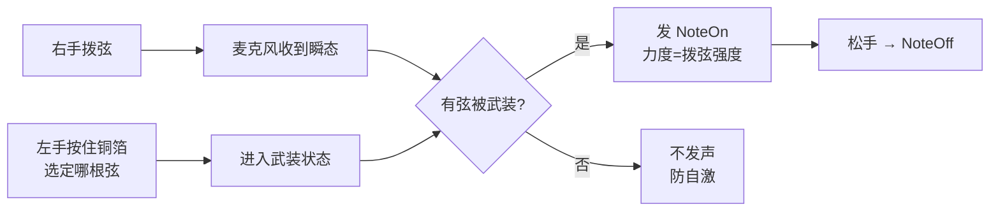

# 无障碍吉他改造 · L2 施工与操作手册

> 一句话定位：ESP32-S3 零采购路线的接线、烧录、验证、调试全流程，照着做就能出声
> 路径：E:\obsidian\项目笔记\无障碍吉他改造\03_L2施工与操作手册.md
> 日期：2026-09-29 · 状态：待接线实测
> 固件：`E:\音乐\档3实现\l2_midi_s3_mic\l2_midi_s3_mic.ino`（麦克风拨弦触发版）
> 上一版（无麦克风）：`E:\音乐\档3实现\l2_midi_s3\l2_midi_s3.ino`

---

## 🎯 一、这一版做到哪了

| 能 | 不能（还没做） |
|---|---|
| 手指按铜箔 = 选弦，右手拨弦 = 出声 | 还没接电磁铁，机器不会替她压弦 |
| 拨弦力度决定 MIDI 力度（强弱归她） | 还没接滑轨，把位靠串口 / 后续旋钮 |
| 同时按住多块铜箔 = 扫出一个和弦 | 还没接喇叭，声音靠 iPad / 电脑音源 |
| 不按铜箔，只拨弦 → **一个音都不发** | 屏幕 / 摄像头：最低优先级，可完全不接 |

**核心突破**：上一版"点触摸就出声"跟右手脱钩。这一版把 NoteOn 的触发权交回右手——**"她没拨弦，一个音都不响"从固件里的一句判断，变成了麦克风层面的事实。**



**防自激是必须的**：装置贴着琴、功放就在旁边，麦克风一定会听到喇叭声。所以"必须有触摸武装才响应"这条闸门不能省——**功放在响、她手没按，麦克风听到了也不发一个音**。

---

## 🔌 二、接线总表

### A. 触摸点（7 个，必需）

| 弦 / 功能 | GPIO | S3 触摸通道 | 备注 |
|---|---|---|---|
| 6弦 E（最粗） | GPIO1 | T1 | |
| 5弦 A | GPIO2 | T2 | |
| 4弦 D | GPIO4 | T4 | |
| 3弦 G | GPIO5 | T5 | |
| 2弦 B | GPIO6 | T6 | |
| 1弦 e（最细） | GPIO7 | T7 | |
| **静音（全停）** | GPIO8 | T8 | 硬规则④：她随时能停 |

**禁用引脚**：GPIO0 / 3 / 45 / 46 是 strapping 引脚（接了开不了机）；GPIO19 / 20 是 USB D-/D+；GPIO26~37 被 Flash / PSRAM 占用。

**铜箔触摸点做法 —— 位置先定，再谈尺寸**

> ⚠️ **最高准则：铜箔不贴在琴上。** 贴在一块独立小板上，板再固定到"她左手自然落点"。
> **位置由她的手决定，不由琴决定。** 这是整件事最容易做错的一步。

**第〇步·先搞清它怎么被触发（不用买任何传感器）**

> **杜邦线本身就是开关。** ESP32 测的是这根线上的电容读数；手指按上去，读数就变了。铜箔只是"放大感应面积的天线"，让这块地方好点，不是为了导电才加的。

三层结构（从下往上）：

| 层 | 材料 | 作用 |
|---|---|---|
| 底 | 亚克力 / 硬纸板 | 绝缘——铜箔**不能**贴在金属或电器件上 |
| 中 | 铜箔胶带（铜面朝上） | 唯一感应面，手指按这里 |
| 上 | 透明胶带 | 隔一层绝缘**照样灵**，防汗、防氧化、防刮 |

**⚠️ 最容易踩的坑**：铜箔胶带**背面是不导电的胶**。导线必须压在**铜面**上（或者用导电胶那一面粘），压错面就是"怎么按都没反应"。

**逐层验证（由简到正式，今天就能做）**：

| 级别 | 怎么做 | 说明 |
|---|---|---|
| 1 | 手指直接捏住杜邦线**裸露的金属头** | 立刻能触发 → 证明线、引脚、固件都对 |
| 2 | 线头用胶带固定在纸板上，露出 1cm 金属，手指点那 1cm | 位置能试，但面积小、要按得准 |
| 3 | 正式：铜箔 + 盖胶带 | 面积大、稳定、耐汗 |

**谁能触发、谁不能**：

- ✅ **她本人的手指**（人体电容耦合）——唯一需要的
- ✅ 握在她手里的金属物件（与身体导通）——可以，但没必要
- ❌ 塑料笔、木棍、绝缘的镊子——一定不行
- ❌ 隔空、戴厚绝缘手套——不行

**芯片那边在干什么**（不用改代码，知道原理便于排查）：读电容 → 和开机基线比（低于 **基线 × 0.55** 判定按住）→ 连续稳定 **25ms** 去抖 → 产生"按下"事件。松手回基线 → "松开"事件。**触摸迟钝就调小该通道的 `TOUCH_RATIO`，误触就调大。**

**三个接线纪律**：

1. 导线**别超过 30cm** —— 越长灵敏度越低、漂移越大
2. 多根导线**分开走**，别平行贴在一起 —— 挨着走会互相串扰误触
3. 线沿琴颈**往后走并用扎带固定** —— 甩来甩去会勾到弦，也干扰她自己的动作

**第一步·三个候选位置（先用魔术贴假固定，别粘死）**

| 区 | 位置 | 优点 | 风险 |
|---|---|---|---|
| **A** | 琴颈下沿（1~4 品外侧） | 离弦近、动手腕就到 | 线走在琴颈旁，容易蹭到 |
| **B** | 琴身左上肩（琴颈结合处） | 支撑面大、稳 | 可能挡她左手扶琴 |
| **C** | **独立小板外挂**（不碰琴，用夹子/挂架引出） | 位置完全自由、不伤琴、好改造 | 需要一个临时支架 |

**先试 A，再试 C。** B 容易档到扶琴的手，放最后。

**第二步·量一个数（这个数决定全部尺寸）**

> 让她坐在**平时的椅子**上、琴放**平时的位置**、左手**自然垂放不动**。
> 然后：**只动手指（不动手腕、不动胳膊）**，从最舒服的点往前后各点，量出**舒适可达的最远两点距离**，记为 **R**。

| 得到 | 怎么算 |
|---|---|
| 节距 | **R ÷ 6**（7 块之间有 6 个间隔） |
| 块宽 | **节距 − 4mm**（间隔不能小于 4mm，否则两片铜箔会互相误触） |
| 整条总长 | 块宽 + 6 × 节距 |

**排不下怎么办**：若 R < 90mm，7 块挤不开。两条路——
1. **减块数**：只保留她最常用的 4~5 根弦（+静音），固件里改 `NUM_TOUCH` 即可
2. **分两排**：3 + 4 前后错开，两排之间留 15mm 以上

**第三步·物理做法**

1. 剪 N 块铜箔胶带（按上面算出的块宽，**方形**），贴在绝缘板上（亚克力 / 硬纸板都行）
2. 每块背面压一根杜邦线（铜箔自带导电胶，压上去就行）
3. **每块上面再盖一层透明胶带**——隔一层绝缘反而更稳，不怕汗、不氧化
4. 相邻铜箔间距 **≥15mm**（这是"防误触底线"，实际按节距走）
5. **先只接 1 根线测通**，确认能触发再全接
6. **排列方向：沿琴颈方向一列。** 横向排会逼她张开手指——那是她的短板，直接排除

**第四步·定死**

她实际试过**三遍**、确认"手自然放着不动就能点到 7 块"，再把魔术贴换成正式固定。**别一次粘死。**

### B. I2S 麦克风 INMP441（模式 2 用）

| INMP441 | ESP32-S3 | 说明 |
|---|---|---|
| VDD | 3.3V | **千万别接 5V，会烧** |
| GND | GND | |
| SCK | GPIO15 | 位时钟 BCLK |
| WS | GPIO16 | 帧时钟 LRCLK |
| SD | GPIO17 | 数据输出 |
| L/R | GND | **必须接**，悬空会随机丢帧 |

> ⚠️ 如果板子上的麦克风已经焊死，请照板子的实际引脚改固件里 `MIC_SCK / MIC_WS / MIC_SD` 三个 `#define`，别硬接。
> ⚠️ 麦克风尽量**贴近琴弦、远离功放喇叭**。

### C. 喇叭 MAX98357A（第 2 步，本版未启用）

VIN→5V · GND→GND · BCLK/LRC/DIN→任意空闲 GPIO · GAIN→GND（12dB） · **SD→3.3V**（不拉高不出声）

---

## ⚙️ 三、烧录检查表

| 项 | 选什么 | 错了会怎样 |
|---|---|---|
| 开发板 | ESP32S3 Dev Module | — |
| **PSRAM** | **OPI PSRAM**（N16R8） | 选错会**无限重启** |
| Flash Size | 16MB | — |
| **esp32 core** | **2.0.17** | 装 3.x → `touchRead()` 废弃，编译直接报错 |
| 库 | **BLE-MIDI** by lathoub | 会自动带上 ArduinoBLE |

---

## ✅ 四、三步验证（照顺序走，每步有预期输出）

**第 1 步 · 只跑触摸，不接麦克风**

1. 烧录 → 开串口（115200）
2. 应看到 7 行基线打印：`6弦E GPIO1 基线=xxxx 阈值=xxxx`
3. 手指按住一块铜箔 → 串口出现 `[选弦] 6弦E 已选中（等右手拨弦）`；松手消失
4. 手机装 **MIDI Wrench**（iOS）/ **MIDI BLE Connect**（安卓）→ 连接 `无障碍吉他`
5. 串口发 `t` → App 上依次跳出 E2 A2 D3 G3 B3 E4
6. 串口发 `1` 切成触摸模式 → 按铜箔立刻出声 → **到这一步，L2 已经成立**

**第 2 步 · 接麦克风，调灵敏度**

1. 按上表接好 INMP441，重新烧录
2. 串口应打印 `[麦克风] 正常。底噪≈xx 拨弦门槛=xxx`
   - 若打印 `没读到有效数据` → 检查接线 / L-R 是否接地 / 是否误接 5V
3. 串口发 `g` 开电平监视 → 安静时应看到 `平均` 是个小数字；**拨一下弦，`峰值` 应明显跳起来**
4. 跳不起来 → 加大灵敏度：发 `-`（每次降 50）
5. 环境变了（换房间）→ 发 `c` 重标定噪声底

**第 3 步 · 联调**

1. 串口发 `2` 切拨弦触发模式
2. 手指按住 6弦E 铜箔（串口显示已选中）→ 拨一下 6 弦
3. 应出现：`[拨弦] 触发 1 根弦 峰值=xxxx 力度=xx` + `[MIDI] ON 6弦E ...`
4. **关键验证**：手离开铜箔，只拨弦 → 串口应打印
   `[拨弦] 检测到拨弦，但没有弦被选中 → 不发任何音（防自激）`
   这一行就是答辩证据——**她没选弦，机器一个音都不响**

---

## 🎚️ 五、两种触发模式

| | **模式 1 · 触摸触发** | **模式 2 · 拨弦触发（推荐）** |
|---|---|---|
| 怎么响 | 按铜箔立刻出声 | 按铜箔=选弦 → 右手拨弦才出声 |
| 力度 | 固定 100 | **由拨弦强度决定** |
| 和弦 | 一次一个音 | 按住多块 → 一次扫弦出多个音 |
| 收音 | 松手停 | 松手停 |
| 没有麦克风时 | ✅ 能用 | ❌ 切不过去（会提示） |
| 答辩叙事 | 机器响应她的选择 | **机器响应她的演奏** |

开机自动探测麦克风在不在，自动选模式；串口 `1` / `2` 可手动切。

---

## 🔧 六、故障排查

| 现象 | 原因 | 处理 |
|---|---|---|
| 串口看不到任何基线打印 | 波特率不对 / USB 线只供电 | 开 115200；换数据线 |
| 板子无限重启 | PSRAM 选项错 | 改成 OPI PSRAM |
| 编译报 `touchRead` 相关错误 | 装了 core 3.x | 回退到 2.0.17 |
| 某块铜箔一直显示按下 | 阈值太松 / 相邻铜箔碰了 | 调小该通道 `TOUCH_RATIO`（0.55→0.45） |
| 某块铜箔按了没反应 | 阈值太严 / 线没接好 | 调大 `TOUCH_RATIO`（0.55→0.7）；重插线 |
| 手机搜不到设备名 | 没连上 / 手机蓝牙占用 | 关掉别的蓝牙设备；重启板子 |
| 麦克风底噪巨大、一直触发 | 门槛太低 / 离喇叭太近 | 发 `+` 提高门槛；发 `c` 重标定；调整麦克风位置 |
| 拨弦不出声、串口也没 `[拨弦]` | 灵敏度不够 | 发 `g` 看电平 → 发 `-` 加灵敏 |
| 一次拨弦响好几下 | 不应期太短 | 改固件 `REFRACTORY_MS`（70→120） |
| 只拨弦就自己响 | 闸门逻辑被改坏了 | 确认"必须先武装"的 `armed[]` 判断还在 |

---

## 📱 七、可发版块

### 7.1 给动手的人 · 30 秒自检流程

```
1. 插 USB → 开串口监视器 115200
2. 看到 7 行"基线" = 触摸好
3. 看到"[麦克风] 正常" = 麦克风好
4. 发 t → 手机 MIDI App 依次跳 6 个音名 = 蓝牙好
5. 按住铜箔 + 拨弦 → 串口出"[拨弦] 触发 1 根弦" = 全通
6. 手离开铜箔只拨弦 → 应打印"没有弦被选中 → 不发任何音"
```

### 7.2 现场对她说的引导词（照念就行）

> 您左手就放这几块铜箔上，按哪块就是选哪根弦——按住不用动。
> 右手该怎么弹就怎么弹，您拨下去它才响，您不拨它一声都不出。
> 想停下来就按最边上那块，全停。

---

## 🔭 八、下一步

| 步 | 接什么 | 得到什么 | 状态 |
|---|---|---|---|
| 1 | 内置触摸 + BLE-MIDI | 点铜箔出音 | ✅ 已完成 |
| 2 | **麦克风 INMP441** | **拨弦触发 + 力度归她** | 🟡 本手册 |
| 3 | 喇叭 MAX98357A | 装置自包含出声，不依赖 iPad | ⬜ |
| 4 | 屏幕 | 音名 / 把位视觉反馈 | ⬜ 最低优先级，可不接 |

**屏幕的口径已定**：只做输出，**不做交互**。她手张不开，虚拟指板点选格子比琴弦还密——否决理由与屏幕大小无关。小屏（1.3 英寸）显示音名 + 把位 + 弦状态就够；现场要观众看清就串口投屏。

---

## 🔗 相关

- [[00_行动计划]] · 总排期与决策清单
- [[01_前人工作与答辩素材]] · 9 个公开先例 + 三条硬知识
- [[02_答辩单页_前人工作]] · 答辩用单页（白底深蓝，投影/打印双适配）
- 逐字稿（能力画像依据）：`E:\音乐\视频转写_逐字稿(1).md`
