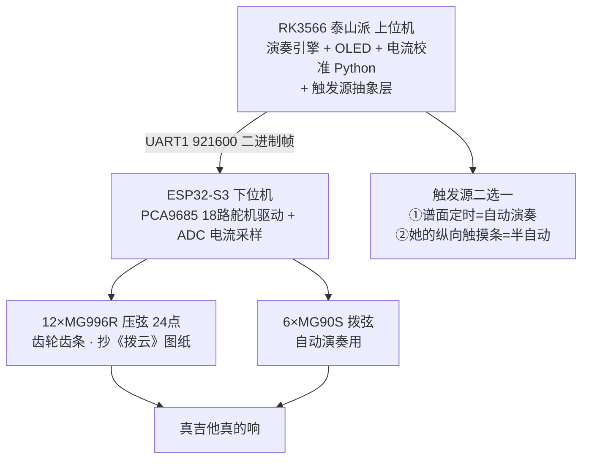
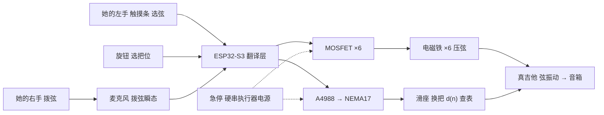

# 无障碍吉他改造 · 档3 v2 方案（机械压弦）

> 一句话定位：**让真吉他真的响**——机器当她的左手，她当自己的右手
> 路径：E:\obsidian\项目笔记\无障碍吉他改造\04_档3v2方案_机械压弦.md
> 日期：2026-09-29 · 状态：目标已锁定，待 ¥60 台架验证（go/no-go）
> 上游：[[00_行动计划]] · 竞品与先例见 [[01_前人工作与答辩素材]]

---

## 〇、目标锁定（2026-09-29 Z 拍板）

- **硬要求：真弹。** 琴本身必须发出那个音——弦被压到品丝上 → 弦振动 → 拾音器出声。
- **关系是"合作"，不是"替代"**：右手归她（拨弦 / 节奏 / 强弱），机器当她的左手（压弦 + 换把）。
- **判据一句话**：如果观众听到的音不是这把琴发出来的，这个项目就没有存在理由——**别人买一台无弦吉他就可以了。**

反过来看这条判据的价值：它同时**砍掉了整个纯电子路线（L2）作为终点**的可能，也**给了答辩一个一眼能懂的差异点**。

---

## 〇+、口径升级（2026-09-30 Z 拍板）：全抄《拨云》整链路 + 泰山派 RK3566 上车

**新口径**：不再从零设计压弦机械，**直接复刻《拨云》完整系统**（12×MG996R 舵机+齿轮齿条压弦、6×MG90S 拨弦、电源板、上位机），上位机用**泰山派 RK3566**（立创开发板，¥200 级）。**先实现自动演奏，再降级为半自动。**

Z 的逻辑："一旦能实现自动演奏，就可以实现半自动演奏，我们做的无非是降级而已。" —— **工程上成立**：半自动是自动的真子集（同一套压弦+驱动链路，只换触发源）。

### 但"降级"的精确含义（三个坑，必须立住）

| # | 坑 | 立住的规矩 |
|---|---|---|
| 1 | **降级不是删功能，是换核心** | 自动演奏的难点是"弹得像人"（时序/力度，抄《拨云》可得）；半自动的难点是"人机配合"（触发延迟/她够得着的交互，必须自己造）。**触发源抽象层一开始就设计进去**：谱面定时器（自动）↔ GPIO 触摸条（她的手），同一个 chord_engine 两个 trigger source |
| 2 | **答辩主场景必须是"她弹"** | 自动演奏是调试工具+演示彩蛋（"我们先把机器左手造好，然后交给她"）；若主打自动演奏，评委一句"跟 LiberLive / 自动钢琴有什么区别"就掉进拼电子的坑。红线不变：**她没有动作时一个音都不响** |
| 3 | **顺序倒排：先半自动后全自动** | 压弦链路跑通 + 她右手拨 = 就能演示；自动拨弦还要调拨片位置/力度/时序，周期不可控，**不能让它卡主线**。全抄采购一次到位，装配调试分两步 |

### 新架构（照抄《拨云》三层）

### 与旧口径的关系

- M3（舵机+齿轮齿条）**从并列候选升为主线**，图纸直接用《拨云》开源件
- M1（电磁铁直压）**降为二期体积优化实验**，样件照买照测（三种型号压秤），但不再卡黑客松
- 换把（v3 滑轨）仍为增量，二期加
- 触发权在人的四条硬规则**不变**——自动演奏只进调试间/彩蛋环节，主演示是她的触摸条

---

## 一、为什么"真弹"是硬要求（价值主张）

### 1.1 竞品就在货架上，不用假设

**LiberLive C1 无弦吉他**（国内电商/官网公开页面，2026-09 抓取）：

| 项 | 事实 |
|---|---|
| 价格 | 国内 **¥1788~2099**；海外 **$359~449** |
| 发声 | **采样合成**（FST 频率仿真 + MicroDAW 采样合成）——**没有弦在振动** |
| 伴奏 | 内置**鼓机 + 实时贝斯铺底**，"一人一支乐队" |
| 和弦 | 琴颈 7 个和弦垫（默认 C Dm Em F G Am Bm）+ A/B 自定义拨片；APP 可扩到 72 个 |
| 单音 | 支持单音演奏与指弹（触摸控制） |
| 其他 | 12 键移调、可折叠、6 小时续航、3.5mm 耳机口、3 英寸低音 + 0.8 英寸高音单元 |

### 1.2 结论：纯电子路线 = 一台更差的无弦吉他

- 拼电子能力，我们**拼不过一台 ¥1800 的成熟商品**：它采样音源、鼓机、贝斯、APP、6 小时续航、可折叠，全部现成。
- 更关键的是：**电子发声对它是卖点，对我们却是减分项**——她面前那把琴不响。
- 所以 Z 的判断是对的：**"真弹"不是技术偏好，是项目能否成立的前提。**

### 1.3 我们唯一站得住的三条

| # | 差异化 | 无弦吉他为什么做不到 |
|---|---|---|
| 1 | **真弦振动发声** | 它没有弦。音色是采样拟合的，不是"这根弦"在响 |
| 2 | **她真的在演奏一把实在的乐器** | 它更像一台"播音设备"；我们的装置拿掉，琴还在、她的手艺还在 |
| 3 | **真琴的指板与换把** | 它不是"不会换把"，是**不需要**——它压根没有指板 |

### 1.4 答辩金句（选一条念）

- **"无弦吉他卖的是'一个人一支乐队'；我们卖的是'一个人，一把真琴，真的在弹'。"**
- "这台机器只做一件她做不到的事——把弦按下去。剩下全归她。"
- "机器在她没有动作的时候，一个音都不会响。"

---

## 二、机器当左手的三条实现（选型对照）

**核心权衡**：机器**压什么**，决定**对位难度**和**力需求**往哪边倒。

| 路线 | 机器压什么 | 对位难度 | 力需求 | 得到的能力 | 参考花费 |
|---|---|---|---|---|---|
| **M1 电磁铁压弦**（主线） | 6 根弦 | **高**（8mm 弦距，需两排交错 + ⌀1 钢琴线细压弦指） | **低**（3~5N，009 弦） | 任意音 + 任意把位（配滑轨） | ~¥250 |
| **M2 舵机压神器按键**（低风险备选） | 神器的 9 个按键 | **低**（按键大，好对准） | **高**（估 20~40N，待测 → 需 MG996R 级大扭矩） | 第一把位固定和弦 | ¥150~250 |
| **M3 舵机 + 齿轮齿条压弦**（《拨云》开源结构）⬆️ | 6 根弦 | **中**（有开源 3D 图纸可抄，不必从零建模） | 低（MG996R 实测够） | 任意音 + 任意把位（配滑轨） | 舵机 3~6×¥15 + 打印件 |

**M1 与 M2 的取舍本质：对位难 ↔ 力需求大，二选一。** 决定权在两组实测数字：

| 待测数 | 怎么测 | 决定什么 |
|---|---|---|
| ① 神器 9 键按键力 | 厨房秤，每键 3 次 | M2 是否可行、要多大的舵机 |
| ② 电磁铁实际压弦力 | 台架，厨房秤压衔铁（**一次测三种型号**） | M1 用哪个型号能留足余量 |
| ③ MG996R 压弦手感与电流 | 台架，按《拨云》结构装一个试压 | M3 是否成立、压弦深度标定方法 |

### 🆕 《拨云》带来的新增量（2026-09-29 Z 发现，详见 [[素材原文/12_自动吉他手拨云_立创开源]]）

立创开源上的**自动吉他手《拨云》**把"舵机压真实吉他弦"整条路走通并**全开源**（3D 图纸 / 原理图 / PCB / 校准代码）。四条直接可用：

1. **MG90S 压不动弦是它的实测结论**（进度表原文：*发现 MG90S 舵机力度不够，更换为 MG996R，效果很好*）→ 我们 Plan B 里的 MG90S×6 作废；走舵机必须 MG996R（¥14.5/个）。
2. **齿轮齿条 + 一舵两点**：一个舵机正反转各压一个点。换算到我们——同把位 6 弦只要 **3 个 MG996R**，执行器数量减半，8mm 弦距的排布难题有现成图纸。
3. **电流采样自动校准压弦深度**：舵机没有力/位反馈，但**压到弦电流会增大**——用 ADC 采样电流变化自动判定"压到了"（截尾均值滤波 + NVS 持久化校准）。**直接解我们"逐弦标定压弦深度"的难题，代码可抄。**
4. **电源板不用自己画**：TPS61088 双路升压（舵机 5A / 主控 2A）+ 电压/温度/电流检测，原理图全开源。

⚠️ **许可**：CC BY-NC-SA 4.0 / PolyForm Noncommercial——黑客松与学习 ✅，**将来商用必须先联系作者授权**。

**为什么 M1 仍是主线、M3 升为并列候选**：M1 电磁铁直压响应 <20ms、无机械传动件、静音；M3 有图纸省建模、力被验证、但多一级齿轮齿条（背隙/噪声/装配）且响应 ~0.1-0.2s。**台架把两种执行器各装一个同台测，数字说话**——现在买样件是"对比测试"，不是"押注某一边"。

**为什么 M1 是主线**：单音模式下同一时刻只 1 路通电（≈1A，5V2A 移动电源够）；零连杆直压、响应 <20ms、静音；⌀14 机身两排交错正好塞进 8mm 弦距。舵机版固件（`chord_servo.ino`）现成，任何一路不行当天回退。

> **采购口径（2026-09-29 Z 二次修正）**：**"零采购"不是本项目的条件，从决策轴里划掉——钱不是约束。**
> 所以 M1 / M2 的选择只由「**能不能做到 + 余量够不够**」决定，**不比价格**。下表的"参考花费"仅供参考预算，不参与打分。

**神器在这一版里的定位**：不是基座，也不拆它——它是 ① 装夹结构的答案 ② 软胶压弦头的零件源 ③ 答辩对比道具 ④ M2 路线里现成的机械压弦引擎。

---

## 三、系统架构（M1 主线）

**读图要点**：

- 左边两路输入都来自**她本人**（右手拨弦、左手选弦/选把位）；ESP32 只是翻译层，**不产生任何音乐决策**。
- 右边两路输出才是机器的手：**压弦**（电磁铁）+ **换把**（滑座）。
- 急停**不走 MCU**，物理串在执行器电源上——硬规则④"她随时能停"的落地方式。

---

## 四、采购与验证顺序（**不是省钱阶梯，是风险阶梯**）

> **口径**：钱不是本项目的约束。分步的唯一目的是**避免一次买错 6 个执行器**。
> 因此——**样件单和批量单同时下单**。样件先到先测，通过就直接启用批量件；不通过就退换改型号（保留 7 天无理由），物流不浪费第二轮。
>
> **三条采购原则**：
> 1. **余量优先**——不卡最低价的临界型号，宁可大一号
> 2. **成品优先于自攒**——买成品同步带直线模组，不自己凑光轴 + 轴承（省下的公差就是省下的调试天）
> 3. **备份件翻倍**——卡箍 / 桥板 / 压弦指各 ×2~3

### 第 0 步 · 今天就能做，不用等件

- 神器按键力测试（换 009 弦 → 厨房秤测 9 键，各 3 次）
- 铜箔触摸点 + 杜邦线（ESP32-S3 与配件已有）
- **用神器跑一遍"真弹"体验**：让她亲手按一次，听真琴的声音——先确认方向对不对

### 第 1 步 · 样件单（与批量单并行下，先到先测）

| 件 | 数量 | 参考价 | 为什么买它 |
|---|---|---|---|
| JF-0530B（5N 级，⌀14） | 2 | ¥20~30 | 体积最小、最容易塞进 8mm 弦距 |
| **JF-1040B（25N 级，同系列大一号）** | 2 | ¥35~50 | 力不够时的当天解法，同时测体积能不能排下 |
| 管式/推拉式大行程电磁铁（备选型号） | 1 | ¥40~60 | 第三种力/行程组合，一次把"力不够"这个最大不确定性打掉 |
| **MG996R 舵机 ×2（+齿轮齿条/3D 打印件，按《拨云》结构）** | 2 | ¥30~45 | M3 对比测试：力被《拨云》实测验证过，同台比一比 |
| ⌀8 光轴 + 直线轴承（或直接买 100mm 成品滑台） | 1 套 | ¥40~80 | 测回零重复精度 |
| A4988 + 散热片 | 1 | ¥10 | 步进回零测试 |
| 杜邦线 / 铜箔胶带 / 泡棉消音条 / 硅胶头 | 若干 | ¥20 | 软性件 |

> **台架现在是"执行器对比测试"**：三种电磁铁 + MG996R 同台压秤，**当天画出「力—体积—响应」曲线，直接定 M1/M3 与型号**，不猜。JF-0530B 标称 5N、压 009 弦的 3~5N 需求正好卡在临界线上——只测一个型号可能得到"不够"却不知道差多少；四个一起测，答案当天齐。

### 第 2 步 · 批量单（与样件单同时下，测通过即启用）

| 类别 | 明细 |
|---|---|
| 执行器 | **按台架对比结论二选一**：电磁铁 ×6（留 2 倍以上余量，不够就 25N 级 / 双线圈并联 / 加一级 2:1 杠杆）**或 MG996R ×3~6 + 齿轮齿条**（《拨云》结构，一舵两点） |
| 滑轨 | **成品同步带直线模组（行程 200mm 级）+ 步进电机** —— 替代自攒光轴 + 轴承，精度与装配时间都更划算 |
| 驱动 | MOSFET 模块 ×6 + 续流二极管（1N5819/1N4007）×6 |
| 电源 | 12V 2A（步进）+ **5V 5A**（电磁铁 + 逻辑；25N 级电流更大，一次给足） |
| 3D 打印 | 卡箍 ×2 + 滑座 + 桥板/压弦指支架，**关键件各做 2~3 份备份** |
| 软性件 | 泡棉消音条 · 毡垫 · 魔术贴 · 铜箔胶带 |

---

## 五、验收标准（数字制，不过就是不过）

| # | 指标 | 标准 | 怎么测 |
|---|---|---|---|
| 1 | 压弦力 | **≥3~5N** | 厨房秤压衔铁读数 |
| 2 | 行程 | 覆盖 **1.5~2mm** 弦距 | 塞尺 / 千分尺 |
| 3 | 温升 | 连续通电 5min **不烫手**（duty 60%） | 手摸 + 红外测温枪 |
| 4 | 回零重复精度 | **±0.5mm**（连续 3 次） | 卡尺 |
| 5 | 换把速度 | **≥100mm/s** | 秒表 + 标尺 |
| 6 | 不伤弦 | 200 次压放**无压痕、不打品** | 目视 + 耳听 |

> 说明：第 1 条的 5N 是 JF-0530B 的**标称值**，不是实测值。公开应用笔记明确警告"普通电磁铁 1~2N 可能不足以压住琴弦"——所以这条必须台架实测。**样件单一次买三个型号，当天压秤比较，直接定型号，不猜。**

---

## 六、固件路线（L2 不是弯路，是驱动层）

**已有（`E:\音乐\档3实现\l2_midi_s3_mic\l2_midi_s3_mic.ino`）**：触摸选弦 / 麦克风拨弦触发 / velocity 由拨弦强度决定 / 静音区 / 麦克风缺失自动降级。

**接机械只做两件事**：

| 步 | 改什么 | 怎么改 |
|---|---|---|
| 1 | 填 `pressString(s)` / `releaseString(s)` 两个**空函数** | M1：`digitalWrite(MOSFET[s], HIGH)` → 200ms 后 PWM 降 60% 保持；M2：`servo[s].write(PRESS_ANGLE)` |
| 2 | 加滑轨模块 | A4988 STEP/DIR + `d(n)=L×(1−2^(−n/12))` 查表（L=有效弦长，零位=琴枕）+ 开机光耦归零 |

**MIDI 这一层一行都不用改。** 这也是为什么 L2 不算白做：它是机械那只手的驱动层，同时是机械趴掉时的现场保底。

**演奏映射表**：先只做 Em-C-G-D 四个和弦（演示曲用），触摸区 → 要压哪几根弦的映射写成一张表，扩曲目就是扩表，不改逻辑。

---

## 七、风险与退路

| 风险 | 触发信号 | 对策 |
|---|---|---|
| 电磁铁力不够 | 台架 <3N | 换 JF-1040B（25N）或在电磁铁与压弦指之间加一级 2:1~3:1 杠杆 |
| 电磁铁发热 | 5min 烫手 | duty 降到 40~60%；无动作即断电 |
| 8mm 弦距对不出位 | 压偏、打品、碰邻弦 | 退 M2（改压神器按键，对位难度骤降） |
| 神器按键力过大 | 厨房秤 >15N/键 | M2 需 MG996R 级舵机或加杠杆，成本上升 |
| 机械整体趴掉 | 现场 | **切 L2 保底**（固件同在，改一个 `#define` 即可） |
| 时间不够 | 赛前 5 天 | 冻结 M1，用 M2 或神器本身做演示 |

**备份件原则**：卡箍、桥板、压弦指各打印 2 份——现场翻车 5 分钟换掉，比任何功能都保命。

---

## 八、已知边界（诚实说明）

- **8mm 弦距下的"两排交错 + ⌀1 钢琴线细压弦指"没有公开先例**，是我们自己的设计。Wiitar（西北大学 2010）自述因"电磁铁太大放不下"从 18 路砍到 6 路，他们没做出来的解法正是这个方向——这既是风险，也是答辩的差异点。
- **电磁铁 5N 是标称值**，能不能压住 009 弦必须台架实测，不可外推。
- **旋钮选把位 + 纵向触摸条选弦**的交互无先例，可用性需要她本人实测（R 值测量见 [[03_L2施工与操作手册]]）。
- 无弦吉他的价格与配置数据来自官网与国内电商公开页面（2026-09 抓取），会随促销浮动。

---

## 🔗 相关

- [[00_行动计划]] · 总排期与决策流水
- [[01_前人工作与答辩素材]] · 9 个公开先例 + 原文归档（`素材原文/`）
- [[02_答辩单页_前人工作]] · 答辩单页（可加"vs 无弦吉他"一节）
- [[03_L2施工与操作手册]] · 接线 / 烧录 / 验证 / 触摸板定位法
- 固件与指南：`E:\音乐\档3实现\`
