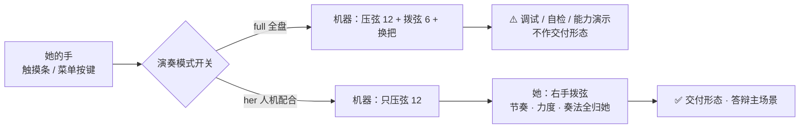

# 23 · 最终形态与两种模式

> **一句话定位**：整台机器最终只有**两种模式**——`full` 全盘（机器全包，调试用）和 `her` 人机配合（机器只当她的左手，**交付形态**）；两者**运行时可切、不重启**。
> 元信息：`E:\obsidian\项目笔记\无障碍吉他改造\23_最终形态与两种模式.md` · 2026-10-01 · 状态 **已落地（待硬件）**
> 关联：[[21_软件缺口清单_到货前]]（第八节）· [[17_小智板接线与烧录SOP]] · [[22_她的手部动作测量表]] · [[04_档3v2方案_机械压弦]]

---

## 一、最终形态

**形态不变的部分**：还是那把真吉他，还是左手压弦 + 右手拨弦。
**唯一变的**：**谁来执行**。

- 全盘模式 = 同一把乐器、**演奏者是机器** → 那是"吉他演奏机"（弦真，人没在弹）
- 人机配合 = 同一把乐器、**演奏者是她** → 这才是吉他

---

## 二、两种模式对照

| | `full` 全盘模式 | `her` 人机配合 |
|---|---|---|
| 机器做 | 压弦 12 + 拨弦 6 + 换把 | **只压弦 12** |
| 她做 | 只点触摸条 | **点触摸条 + 右手拨弦 + 节奏/力度/奏法** |
| 动作集 | `[chord, strum, position]` | `[chord]` |
| 用途 | 调试 / 自检 / 机械能力演示 | **交付形态 / 答辩主场景** |
| 规矩 | ⚠️ **不上台**（硬规则④） | 硬规则②（右手零改造）在此成立 |
| 现状 | **默认**（建设期先抄全《拨云》） | **答辩前必须切到这个** |

---

## 三、怎么在原来的基础上改造（只加了一层开关）

《拨云》原有的三层链路**一层都没拆**，改造只发生在**第二层加一个开关**：

| 层 | 原状（拨云） | 我们的改造 | 动了吗 |
|---|---|---|---|
| **输入层** | 谱面定时器自动演奏 | 加**她的触摸条**（TTP223×6）+ 菜单兜底入口 | 加触发源（不动原逻辑） |
| **决策层** | 谱面 → 舵机角度 | 加**动作集开关** `trigger.actions`（= 模式） | ★ **唯一新增的一层** |
| **输出层** | ESP32 传 18 路帧给 PCA9685 | 换成小智 ESP32-S3 板 + 外接 MAX471 | 换板不改协议 |
| **执行层** | 12 压弦 + 6 拨弦 + 换把 | **完全沿用**（M3 舵机版主线） | 未改 |

> 一句话：**改造 = 在"谱面说什么"和"舵机做什么"之间插了一层"这台机器被允许做多少"的过滤器。**
> 减法不是删代码——**是关开关**。

---

## 四、运行时切换怎么用（两条路径）

| 路径 | 怎么用 | 场合 |
|---|---|---|
| **菜单**（已实现） | 设置界面 → **「演奏模式」** → UP/DOWN 选 → SET 切 | 调试、答辩现场 |
| **配置文件**（启动值） | `config/config.yaml` → `trigger.actions` | 开机默认模式 |

- 切换**立即生效**：只改内存里的动作集，**不写配置文件、不重启程序**。
- 切换**不松弦**：不会打断她正压着的和弦。
- 未知模式名 → **保持不变**（绝不切进没验证过的集合）。

---

## 五、本轮改动清单（有测试证据）

| 文件 | 改动 |
|---|---|
| `trigger_source.py` | 新增 `MODE_FULL`/`MODE_HER`/`MODE_LABELS`/`MODE_ACTIONS`/`DEFAULT_MODE`；`PerformanceController.mode` 属性、`set_actions()`、`set_mode()` |
| `trigger_integration.py` | `HerPerformance.perf_mode`、`set_mode()`、`mode_names()`（与 `self.mode`=触发源 分开，别混） |
| `menu_system.py` | root 第二位新增「**演奏模式**」→ `performance_mode_ui` |
| `screen_functions.py` | 新增 `performance_mode_ui()`；「她的演奏」标题栏显示当前模式 |
| `config.yaml` / `config.example.yaml` | `trigger.actions` 注释改写为**两种模式**说明 |
| `_test_modeswitch.py` | **新建**：full↔her 双向切换、未知输入保护、门面同步 |
| `_test_menu_entry.py` | 扩展：模式界面 SET 切模式、**切模式不松弦** |

**验证结果**（全部实跑）：

| 测试 | 结果 |
|---|---|
| `_test_modeswitch.py` | ✅ A 默认 full 拨到 point_b / B her 连续两拨恒 idle / C 切回 full 恢复 A/B 交替 / D 垃圾名保持不变 / E 门面同步 |
| `_test_menu_entry.py` | ✅ 调用链 `[('set_mode','her')]`，切模式与退出均**不松弦** |
| `_test_actionset.py` / `_test_hold_release.py` / `_test_integration.py`（回归） | ✅ 全过 |
| `py_compile`（5 文件） | ✅ 通过 |

---

## 六、纪律与边界（不许违背）

1. **全盘模式永远只是调试工具**，不作交付形态（硬规则④：自动演奏不上台）。
2. **答辩 / 验收前必须切到 `her`**，否则违反硬规则②（右手零改造）。
3. **切 `her` 不是"少做一个动作"，是换了一种乐器**——三条新问题必须处理（见 [[21_软件缺口清单_到货前]] 8.2）：
   ① 压弦**无声**，需给她「和弦已就位，请拨弦」提示；
   ② 压弦保持时间变长 → **舵机发热**（M1 电磁铁翻身的理由）；
   ③ "何时拨"没有节拍锚点。
4. **`self.mode`（触发源 touch/timer）与 `self.perf_mode`（模式 full/her）是两件事**，永远别混。
