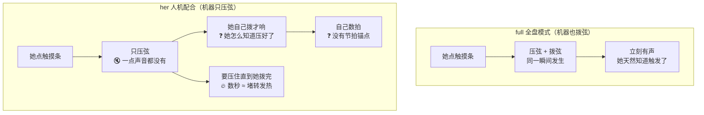
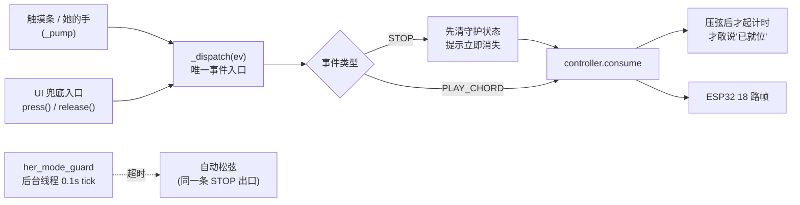

# 24 · her 模式守护层：就位提示 / 保持超时 / 节拍锚点

> **一句话定位**：把「人机配合（`her`）模式」在 `full` 全盘模式下**根本不存在**的三个工程缺口一次闭合——压弦无声、舵机保持发热、无节拍锚点。
> 路径：`src/guitarist/her_mode_guard.py` · 日期：2026-10-01 · 状态：✅ 已实现 + 10 段单测全绿（PC 侧）

关联：[[23_最终形态与两种模式]] · [[21_软件缺口清单_到货前]]（第八节）· [[17_小智板接线与烧录SOP]]

---

## 一、为什么必须有这一层

Z 定调的两种模式里，`her` 是**交付形态 / 答辩主场景**。但"把右手还给她"这个动作本身，会**同时**引出三个问题——它们在 `full` 模式下**一个都不存在**：



| # | 缺口 | 全盘模式为什么没这个问题 | 后果（her 模式） |
|---|---|---|---|
| ① | **压弦无声** | 压弦和拨弦同一瞬间，声音就是天然反馈 | 她无法感知"机器压到位了没有" |
| ② | **保持时间变长** 🔴 | 保持只有一瞬 | 12 路 MG996R 持续接近堵转 → 发热 / 掉扭矩 / 耗电飙升 |
| ③ | **无节拍锚点** | 机器拨弦自带时点，她只要听 | 她得自己数拍，不知道"什么时候拨" |

> 《拨云》原作里这三件事**一行代码都没有**——因为它只做全自动，从没有过"人机配合"这个形态。

---

## 二、三个机制

### ① 就位提示（对应缺口 ①）

压弦成功 → 立刻给一行提示：**「C 已就位 请拨弦 4」**（末尾数字是预备拍倒计）。

两条显示通路：

| 通路 | 位置 | 说明 |
|---|---|---|
| 主界面底部横幅 | `oled_renderer.show_main_screen` | `her_hint` 非空时**优先**占据底部（压过"叫我 XX 唤醒我"） |
| 演奏界面首行 | `screen_functions.her_performance_ui` | 有提示时**顶掉**模式标题（她演奏中要的是"能不能拨了"，不是"现在什么模式"） |
| 音频提示（可选） | `trigger.guard.audio_hint: true` | 她眼睛在琴上、不看屏 → **声音通常更有效**。默认关（见"诚实边界"） |

### ② 保持超时保护（对应缺口 ②，**唯一的安全机制**）

```
压弦 → [计时开始] → 75% 上限：「即将自动松弦」预警一次
                  → 100% 上限：自动松弦 + 提示「已超时松弦」
```

- 超时默认 **45 秒**（`hold_timeout_s`），预警在 **75%**（`warn_ratio`）。
- 超时松弦走的是**与手动松弦完全相同的那一条出口**（`controller.consume(STOP)`），不新增第二条松弦路径。
- 为什么要有预警：她正拨到一半弦突然松掉会很怪；先给一次提示，她能主动收尾。

> ⚠️ **超时自动松弦是"释放"不是"触发"**——它不发任何声音，所以不违反硬规则①（触发权在人）；恰恰相反，它是硬规则④「她随时能停」的机器侧补强：人没来得及停时，机器替她兜一手。

### ③ 预备拍倒计（对应缺口 ③）

就位后按 `bpm` 给出 `count_in_beats` 拍倒计（默认 60bpm / 4 拍），显示在提示行末尾：`请拨弦 4` → `3` → `2` → `1`。

---

## 三、架构：单一事件入口（本轮顺手修掉的真 bug）

原来触摸条事件在 `_pump` 里**直接调 `controller.consume()`**，绕过了门面——意味着**她的主触发路径（触摸条）不受任何守护**。已改为统一走 `_dispatch()`：



顺序讲究（写在代码注释里）：
- **STOP**：先清守护状态 → 再松弦。她一停，提示立刻消失。
- **PLAY_CHORD**：先压弦 → 再起计时。压上了才敢说"已就位"。

---

## 四、改动清单

| 文件 | 改动 |
|---|---|
| **`her_mode_guard.py`** 🆕 | 守护层本体（纯逻辑，不 import 任何硬件；`clock` 可注入 → 可单测） |
| `trigger_integration.py` | `HerPerformance` 装配守护；新增**唯一入口** `_dispatch()`；`guard_status()` / `hint_text()` / `set_hint_channel()`；`start/stop` 带守护线程；`build_her_performance` 按配置挂音频通道 |
| `oled_renderer.py` | `show_main_screen` 底部横幅支持 `her_hint`（优先级高于常规提示） |
| `screen_functions.py` | `her_performance_ui` 首行优先显示提示 |
| `main.py` | `collect_main_screen_info` 注入 `her_hint`（`_her_hint_text()` 全程 try/except） |
| `config.yaml` / `config.example.yaml` | 新增 `trigger.guard` 段 |
| **`_test_her_guard.py`** 🆕 | 10 段单测 |

### 配置项

```yaml
trigger:
  guard:
    enabled: true          # 总开关
    hold_timeout_s: 45     # 压弦保持上限（秒），超时自动松弦
    warn_ratio: 0.75       # 到上限 75% 先预警一次
    bpm: 60                # 预备拍速度
    count_in_beats: 4      # 预备拍数（0 = 关闭节拍锚点）
    audio_hint: false      # true 时用提示音（需 prompts/*.mp3 + 音频输出）
```

---

## 五、验证证据（`_test_her_guard.py`，10 段全绿）

```
A. 压弦 → 就位提示 + 预备拍        hint='C 已就位 请拨弦 4'  beats_left=4  ready✅
B. 时间推进：预备拍递减、超时倒计   held=2.5s beats_left=2 timeout_in=7.5s ✅
C. 预警（70% 处发一次，不重复）     warn 一次且仅一次 ✅
D. 超时 → 自动松弦（且只松一次）    released=1 次 ✅
E. 松弦后不再受超时影响            松弦后 tick 静默 ✅
F. generation 隔离：换和弦后旧计时作废  held=1.0s（新计时）✅
G. enabled=False 时不做超时保护    禁用时不超时 ✅
H. 从配置构建                      配置覆盖=20.0s/90.0bpm/3拍  默认=45.0s ✅
I. 后台线程可启停                  start/stop 正常 ✅
J. 集成：HerPerformance 全链路     压弦→预警→超时自动松弦→手动松弦清提示→触摸条路径同步守护 ✅
```

回归：`_test_menu_entry` / `_test_modeswitch` / `_test_actionset` / `_test_hold_release` / `_test_integration` **全过**；6 个改动文件 `py_compile` 通过。

---

## 六、诚实边界（已知未闭合）

1. **音频提示默认关。** `audio_hint: false`——因为（a）`prompts/chord_ready.mp3` 尚未生成（b）`mpg123/ffplay` 需系统音频（c）**泰山派是否接了音频输出还没实测**。三者任一缺失会静默降级为屏幕提示并只警告一次。现场确认有音频后，生成两个 mp3（`chord_ready` / `her_timeout`）再打开开关即可。
2. **45s 是估值，不是实测值。** 真正的上限应来自"12 路 MG996R 保持多久开始明显温升"的实测（拨弦调试时顺带测：压住不放 5s / 15s / 30s，记录温升与电流）。到时按实测改 `hold_timeout_s`。
3. **节拍锚点是"显示"，不是"发声"。** 现在只在屏上倒计；她若不看屏则无效——这正是音频提示（`audio_hint`）存在的意义。二期可考虑节拍器音（ESP32 端直接发声，不占串口）。
4. **主界面 `her_hint` 快照在 RGB16/128×64 上是**单行 21 字符以内**——超过会走跑马灯（`marquee_offset`），目前文案最长 `"C 已就位 请拨弦 4"` = 10 字，安全。

---

## 七、与答辩的关系

答辩主场景必须切 `her`。切了之后，评委看到的是：

- **她点一下 → 屏上/耳边出现「和弦已就位」→ 她右手拨出声音**（而不是机器自己响）
- **中间没有任何"机器替她演奏"的动作**

这三条机制的存在，正是为了让她**敢于**按下触摸条、并且**知道**该什么时候拨——它们是"她真的在演奏"这个叙事的**工程支撑**，不是附加功能。
