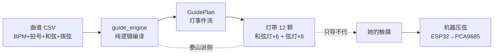
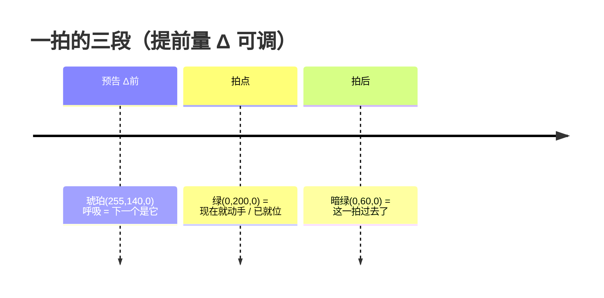

# 40 · 导练层（跟练模式）

> **一句话定位**：给她的"眼"——把曲谱编译成灯带事件流，**提前告知**下一个和弦碰哪、该拨哪几根弦；灯只导不代，机器仍只压弦，音由她拨出。
>
> 路径：`E:\音乐\拨云_开源参考\liguanxi_Automatic_guitar\`
> 代码：`src/guitarist/guide_engine.py`（引擎）· `src/guitarist/_test_guide_engine.py`（单测）
> 配置：`config/config.yaml` → `trigger.guide`
> 日期：2026-10-09 · 状态：**PC 版完成，10/10 测试通过；等灯带接泰山派 SPI**
> 上游：[[39_她的演奏档案_记录层]] · [[23_最终形态与两种模式]] · 相关：[[37_放大屏一期_1.83寸彩屏替换]] · [[38_MAX471电流采样接线与验收]]

---

## 🎯 一句话

**自由弹**（现 her）灯只能"碰了才亮"（响应式）；**跟练**（新增）有谱在走，机器**早知道下一步**，灯才能"提前亮"。
所以这不是给彩灯加功能，是**新增一个"跟练"玩法**——与 her 并列，由开关控制，不冲突。

## 📦 要加什么

| 类别 | 内容 | 数量 |
|---|---|---|
| 🔌 硬件 | WS2812 灯带**已下单**，30 颗取 12 用、18 备 | **0 件新购** |
| 🧠 引擎 | `guide_engine.py` 纯逻辑：曲谱 → 灯事件流 | 1 文件（✅ 已写） |
| 🎛 开关 | `trigger.guide.enabled`（默认关） | ✅ 已加 |
| 💡 灯驱动 | 泰山派 SPI 驱动 WS2812（`led_strip.py`） | ⏳ 灯到货后 |

**接线**：`DIN → 泰山派 SPI`（板定义 `MOSI=GPIO4_C3 / SCLK=GPIO4_C2`，物理脚号待对 40PIN 图核）+ 5V/GND 取 PCA 的 V+ 轨 + 共地。



## 💡 灯语言（三态）



| 灯组 | 装哪 | 负责 |
|---|---|---|
| **和弦灯 ×6** | 6 个触摸方块背面 | 预告"下一个碰哪个方块" |
| **弦灯 ×6** | 沿 6 根弦（琴桥/音孔附近） | 预告"该拨哪几根弦 + 扫弦方向 ↑↓" |

- **提前量 Δ**：默认 `lead_ms=850`（≈70BPM 一个四分音符）；新手可设整拍预习，熟手减半。
- 30 灯带取 **12 颗**（6+6），余 18 颗全备份——这也是买整米而非散买的原因。

## 🔗 数据来源（全是现成的，不造新数据）

| 事实 | 来源 | 用途 |
|---|---|---|
| 曲谱自带 **BPM + 拍号** | 曲谱 CSV 首行 | 节拍基准 |
| `横线数量` → 时值 | dash 0→857ms / 1→428 / 2→214（基准 70BPM） | 时间线 |
| `区域1..6` → 拨哪几根弦 | 非空即拨 | 弦灯 |
| `1弦..6弦` → 品位 | 空值继承上一行 | 形状→和弦名反查 |
| `类型` → 和弦名 | 如 Cadd9 | 形状反查失败时兜底 |
| 和弦名 ↔ 形状 | `data/chord_definitions.csv` | 保证与机器实际压的一致 |
| 和弦名 → 方块 | `trigger.chord_map` | 和弦灯指路 |

> 关键：`ServoController.precompute_song` 早就算出每拍"压哪个和弦、拨哪几根弦、多久、什么方向"，只是没告诉灯。**我们做的是把已有数据喂给灯。**

## 🧩 引擎 API

```python
from guide_engine import compile_guide_plan, build_guide_from_config

plan = compile_guide_plan("曲谱.csv", lead_ms=850, strum_lit_ms=320)
lamps = plan.state_at(3200.0)      # → 12 个 (r,g,b)，灯驱动按 ~50Hz 轮询
evs   = plan.events()              # → (t_ms, group, idx, state) 事件流
kfs   = plan.keyframes()           # → 状态变化关键帧（离线验证/落档）

# 或从配置（trigger.guide.enabled=false 时返回 None）
plan = build_guide_from_config(config, "曲谱.csv")
```

**PC 验证 CLI**（灯到货前先看节奏）：

```bash
unset PYTHONPATH
.venv/Scripts/python.exe src/guitarist/guide_engine.py <曲谱.csv> --dump          # 时间线表
.venv/Scripts/python.exe src/guitarist/guide_engine.py <曲谱.csv> --strip 8       # ASCII 灯语言条
.venv/Scripts/python.exe src/guitarist/guide_engine.py <曲谱.csv> --play 8 --speed 1  # 实时色块
```

**用《晴天》实测输出**（节选）：

```
和弦C   ###################################..............................PPPP#
和弦G   ..............................PPPPP##################################.
弦3    PPPPP###-PPPP####-........PPPP####-........PPPPP###-.................P
弦4    ####-.............PPPPPP##.........PPPP###-......................PPPP#
      0         1         2         3         4         5         6     (每格100ms)
```

读法：**P 预告（琥珀）→ # 进行（绿）→ - 完成（暗绿）→ . 灭**。和弦C 亮绿时，和弦G 在下一拍前后 `PPPPP` 提前亮起——这就是"提前量"。

## ⚠️ 已知边界（诚实说明）

1. **和弦灯受"6 方块"约束**：触摸方块是 6 个（C/G/Am/F/Dm/Em）。曲谱若用和弦集外的和弦，**和弦灯不亮、弦灯照常**。
   - 《晴天》原谱 611 拍里有 **175 拍**用了集外和弦（Dsus4×87、B7×35、A7sus4×22、D/F×19、D×8、D9×4）→ 引擎 `warnings` 已列出。
   - 结论：**跟练一期适用于"6 和弦以内"的曲目/简化谱**；超集和弦需改编或扩方块（二期）。
2. **首拍无预告**：曲首之前没有时间，第一拍的和弦灯直接亮绿（无琥珀预习）。
3. **和弦名映射规则**：形状精确匹配优先 → 最长前缀模糊（Cadd9→C、Gsus4→G、Am7→Am、Cmaj7→C）→ 无匹配则和弦灯不亮。模糊匹配会打 `~` 标记。
4. **两个时钟会漂移**：灯在泰山派、压弦在 ESP32，毫秒级漂移；用"发歌起点同步"对齐，70BPM 下一拍 857ms，抖动 <1%，可忽略。

## 🛡️ 硬规则守护

| 硬规则 | 本层如何守 |
|---|---|
| ① 触发权在人 | 灯只"告知"，**不替她弹**；她碰才压弦（压弦路径一字未改） |
| ② 右手零改造 | 弦灯只是"提示"，她的手照常在真弦上拨 |
| ③ 自动演奏不上台 | 灯不出声、不弹音，只做视觉导练 |
| ④ 她随时能停 | 跟练是**开关**不是强制模式；关掉即回自由演奏 |

## ✅ 验证

- 单测 `_test_guide_engine.py`：**8 组 45 项断言全通过**（曲谱解析 / 和弦反查 / 方块映射 / 编译 / 三态 / BPM 缩放 / events·keyframes / 边界）
- 全套回归：`bash run_tests.sh` → **10/10 通过**（8 套 → 9 套 → 10 套）
- 真曲谱冒烟：《晴天》611 拍编译成功，和弦/拨弦/扫弦方向正确解析

## 📋 下一步

1. 灯带到货 → 焊 6+6 段 → 接泰山派 SPI（先核物理脚号）
2. 写 `led_strip.py`（泰山派 SPI 驱动 WS2812），把 `plan.state_at(t)` 接到真灯
3. 集成到播放循环（曲谱走起来时灯跟着走）+ OLED 显示当前和弦名
4. 一期升级包结论同步 [[25_技术方案报告]]
