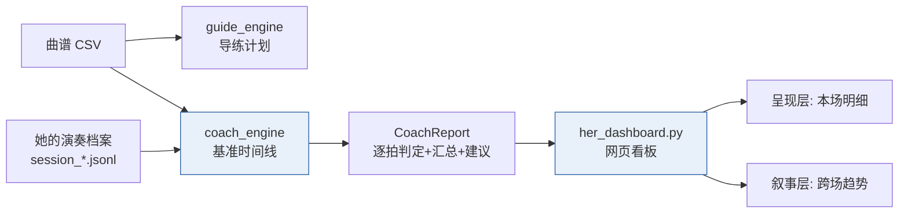

# 41 · 理解与呈现层 · 教练引擎与看板

> 一句话定位：**导练引擎是"眼睛"（事前告诉她该做什么），教练引擎是"记分牌"（事后评她做得怎样），看板把两者变成"能看见、能证明"的证据链。**
> 元信息：路径 `E:\音乐\拨云_开源参考\liguanxi_Automatic_guitar\` · 日期 2026-10-09 · 状态 **PC 版落地，10/10 测试通过**
> 关联：[[40_导练层_跟练模式]] · [[39_她的演奏档案_记录层]] · [[25_技术方案报告]]

---

## 🎯 为什么做这一层（Z 定调）

泰山派（RK3566）跑演奏控制其实很轻，算力/内存大量富余。但"富余"不是理由——真正的理由是：

> **它是整套系统里唯一同时会「算、连、显」三件事的节点。**

所以它该干的不是"把闲置算力用起来"，而是**把只有它能做的事做掉**：把"她真的在演奏"变成**可测量、可展示、可回顾**的证据。

| 层 | 定位 | 输入 | 输出 | 状态 |
|---|---|---|---|---|
| **导练层** | 事前：灯提前告诉她下一步 | 曲谱 | 灯事件流 | ✅ 40 号（PC 版） |
| **理解层** | 事后：逐拍评她早/准/晚/漏 | 曲谱 + 她的档案 | 教练报告 | ✅ 本篇（PC 版） |
| **呈现层** | 当下：把结果画出来 | 教练报告 | 网页看板 | ✅ 本篇（PC 版） |
| **叙事层** | 长期：把每场汇成能力曲线 | 多场档案 | 趋势 + 明细表 | ✅ 本篇（PC 版） |



---

## 🧠 理解层：教练引擎 `coach_engine.py`

**纯逻辑、零硬件**（与 `her_recorder` / `guide_engine` 同款纪律）。

### 判定口径（对每个"有和弦"的拍）

| 判定 | 条件 |
|---|---|
| **准** | 窗口内找到**和弦正确**的按压，且 `|偏差| ≤ on_ms`（默认 120ms） |
| **早 / 晚** | 同上但偏差超容差（`早=负`、`晚=正`） |
| **漏拍** | 窗口内什么都没碰 |
| **误按** | 窗口内没碰对和弦，但碰了**别的和弦** |
| **多余按压** | 落在所有窗口之外的按压 |

窗口 = `[onset − early_tol, onset + late_tol]`（默认 ±450ms）。

### 时间对齐（关键）

档案的 `t` 是"相对本场开始"的秒；曲谱的 `t_ms` 是"相对曲首"。**原点不同，必须先对齐**：

- `align="first"`（默认）：她第一次按压 ↔ 第一个有和弦的拍（符合跟练模式）
- `align="zero"`：档案起点即曲首
- 显式 `offset_ms`：直接给定

### 场次汇总

命中率 / 准时率 / 漏拍 / 误按 / 多余 / **平均偏差（带偏向：偏早·偏晚·准）** / **平均绝对偏差** / **波动 σ** / 综合稳定度（命中×0.6 + 准时×0.4）/ **各和弦分解** / **文字建议**。

> 偏向判据：`|平均偏差| ≥ 半个容差` 即判"偏早/偏晚"，避免"均值居中但明显偏一侧"被误读成"准"。

---

## 📊 呈现层 + 叙事层：`tools/her_dashboard.py`

生成**自包含、可离线打开**的 HTML（白底深蓝商务风，内联 SVG，零外部依赖）。

| 区块 | 内容 | 层 |
|---|---|---|
| KPI 卡 | 综合稳定度 / 命中率 / 准时率 / 平均偏差 / 波动σ / 漏拍·误按 | 呈现 |
| **全曲状态条** | 每一拍一个色块（准绿/早琥珀/晚红/漏灰/误紫），整曲一眼看 | 呈现 |
| **偏差散点** | 横轴时间、纵轴 Δms（早负晚正），灰带 = ±120ms 准时区 | 呈现 |
| **各和弦表现** | 命中率横向柱 + 样本数 + 平均偏差 | 呈现 |
| **训练趋势** | 命中率·准时率折线 + 平均绝对偏差折线 | 叙事 |
| 档案指标 | 每场换和弦次数柱 | 叙事 |
| 场次明细表 | 时间/时长/换和弦/命中率/准时率/偏差/超时 | 叙事 |

---

## 🛠 用法（PC 版，零硬件）

```bash
# 教练报告（控制台）
python3 src/guitarist/coach_engine.py <曲谱.csv> --dir logs/performance --last
python3 src/guitarist/coach_engine.py <曲谱.csv> --last --align zero --on 150   # 调参
python3 src/guitarist/coach_engine.py <曲谱.csv> --detail 80                    # 看更多逐拍

# 网页看板（单场明细 + 跨场趋势）
python3 tools/her_dashboard.py \
    --song "歌曲列表/晴天/图片源2/输出结果（deepseek纠正版本）.csv" \
    --dir logs/performance --limit 12 --out output/her_dashboard.html

# 造演示档案（⚠️ 非真实数据，仅用于预览看板）
python3 tools/gen_demo_sessions.py \
    --song "歌曲列表/晴天/图片源2/输出结果（deepseek纠正版本）.csv" \
    --out output/demo_performance
```

配置开关（`config.yaml → trigger.coach`，**默认关**）：

```yaml
  coach:
    enabled: false    # 关掉即回到"只记录不评分"（减法纪律）
    on_ms: 120
    early_tol_ms: 450
    late_tol_ms: 450
    align: first
```

---

## 📁 代码落点

| 文件 | 作用 |
|---|---|
| `src/guitarist/coach_engine.py` | 教练引擎主体（纯逻辑 + 控制台 CLI） |
| `src/guitarist/_test_coach_engine.py` | 单测（8 组 40 项断言，已并入 `run_tests.sh`） |
| `tools/her_dashboard.py` | 看板生成器（呈现 + 叙事） |
| `tools/gen_demo_sessions.py` | 演示档案生成器（非真实数据） |

`run_tests.sh`：**10 套 → 11 套**。

---

## ⚠️ 已知边界（诚实说明）

1. **只有"压弦（碰方块）"被评判**。目前没有拨弦传感器——her 模式下她拨弦的动作**采不到**，所以教练只评"和弦触摸的时机与准确度"，不评拨弦力度/音准。要评拨弦需二期加音频分析（见待办）。
2. **和弦灯受"6 个方块"约束**。《晴天》611 拍里只有 C/G/Em 三种能映射到方块（其余 Dsus4/B7… 无方块）→ 只有 436 拍参与评判。跟练/评判一期适用"6 和弦以内"的曲目。
3. **对齐依赖"她第一下就跟第一拍"**。若她中途才开始，需用 `--offset` 手动给偏移，或后续做"自动最佳对齐"。
4. **看板是静态快照**，非实时刷新（实时版可挂泰山派本地服务，复用 [[35_网页远程访问_USB转发]]）。
5. **演示数据非真实**：`output/demo_performance/` 是合成档案，只用于预览看板，**不要与 `logs/performance/` 真实档案混放**。

---

## 🔗 与硬规则对齐

| 硬规则 | 本层如何守 |
|---|---|
| ① 触发权在人 | 教练**只读**她的动作，绝不产生任何触发 |
| ② 右手零改造 | 只评判触摸时机，不碰拨弦/硬件 |
| ③ 自动演奏不上台 | 教练/full 回放只进调试间 |
| ④ 她随时能停 | 整体是开关（`trigger.coach.enabled`），关掉即回到"只记录" |

---

## ▶️ 下一步（按优先级）

1. **上板攒真实数据**：`record.enabled=true` → 她真弹几场 → pull 档案 → 跑教练 + 看板（当前全是演示数据）
2. **实时化**（可选）：把教练判定接 OLED / 灯带，当场给她反馈（"这一拍晚了"）
3. **拨弦感知**（二期）：接音频/电流做"拨弦时机"评判（MAX471 的 AIN1 拨弦组已在硬件里预留）
4. 结论同步 [[25_技术方案报告]]（含"可扩展性：三乐器仅二期"）
