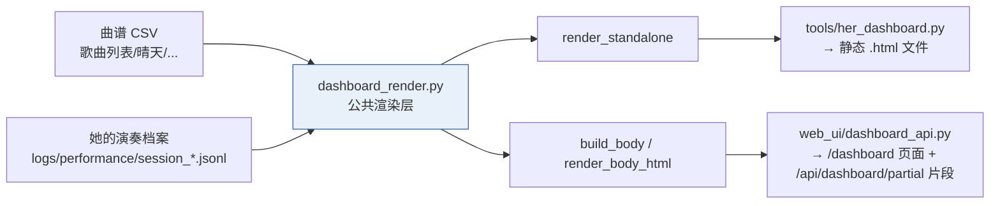

# 42 · 动态看板 · 并入管理页

> 一句话定位：**把「她的演奏看板」从"一个要自己生成、自己去打开的文件"，升级成《拨云》管理页里的一个标签页——打开网页就在，数据实时刷新。**
> 元信息：路径 `E:\音乐\拨云_开源参考\liguanxi_Automatic_guitar\src\guitarist\web_ui\dashboard_api.py` · 日期 2026-10-09 · 状态 **PC 版落地，13/13 测试通过**
> 关联：[[41_理解与呈现层_教练引擎与看板]] · [[39_她的演奏档案_记录层]] · [[35_网页远程访问_USB转发]] · [[25_技术方案报告]]

---

## 🎯 为什么做（Z 的三个要求）

Z 原话拆开是三件事：

1. **要动态看板，不要静态看板** → 数据得实时，她还在弹就能看到
2. **要和管理页合并在一起** → 不是另开一个文件/网址，是管理页里的一个页面
3. **平时也想看** → 随手打开就能用

**这就分出了两个"网页"，之前它们被混为一谈：**

| | **她的演奏看板（本层）** | **《拨云》管理页**（35 号） |
|---|---|---|
| 本质 | 一个 `.html` 文件（静态版） | 板上跑的 Flask 服务 |
| 要开机吗 | ❌ 不用（静态版） | ✅ 要 |
| 动态版在哪 | **并入管理页 = 也要开机**（它就是板子上的服务） | 同左 |

→ 结论：**Z 要的是"动态版"，它天然跑在泰山派上、需要开机——但换来的是"打开管理页就有、且实时"。** 静态版保留，用于"发链接/离线看"。

---

## 🏗 架构



**关键：渲染逻辑只有一份**（`dashboard_render.py`），静态版和动态版共用 —— 两边长得一模一样，不会漂移。

---

## 📁 改动清单

| 文件 | 类型 | 作用 |
|---|---|---|
| `src/guitarist/dashboard_render.py` | 🆕 | **公共渲染层**：视觉规范 / SVG 元件 / 正文组装 / 曲谱发现 / 进行中兜底汇总 |
| `src/guitarist/web_ui/dashboard_api.py` | 🆕 | **看板蓝图**：`/dashboard` 页面 + `/api/dashboard/partial` 片段 |
| `src/guitarist/web_ui/templates/dashboard.html` | 🆕 | 页面模板（继承 `base.html`）：工具条 + 轮询脚本 |
| `src/guitarist/web_ui/templates/base.html` | ✏️ | 侧边栏加「**演奏看板**」标签（系统信息之后） |
| `src/guitarist/web_ui/__init__.py` | ✏️ | fail-soft 注册蓝图（照 `logs_api` 范式，**不动 22 万字符的 api.py**） |
| `tools/her_dashboard.py` | ✏️ | 改为瘦 CLI，复用 `dashboard_render` |
| `src/guitarist/_test_dashboard_render.py` | 🆕 | 公共渲染层单测（5 组） |
| `src/guitarist/_test_dashboard_api.py` | 🆕 | Flask 冒烟测试（4 组，test_client） |
| `run_tests.sh` | ✏️ | **11 套 → 13 套** |

---

## 🔌 路由与鉴权

| 方法 | 路径 | 鉴权 | 说明 |
|---|---|---|---|
| GET | `/dashboard` | 否（与既有页面一致） | 服务端首渲染 → 无 JS 也能看，首屏不闪 |
| GET | `/api/dashboard/partial` | ✅ `require_auth` | 返回**片段 HTML**，前端轮询换 `innerHTML` |

可选查询参数：`?song=<相对项目根的曲谱CSV>&limit=<场次数>`

**鉴权怎么放行手机的**：本仓库既有规矩是"**页面开放、`/api/*` 鉴权**"。未配 `WEB_API_KEY` 时，`api._is_localhost()` 放行 `127.0.0.1` / `192.168.x` / `10.x`（非 100.x）/ `172.16-31.x` —— **手机连同一 WiFi（192.168.x）即可正常自动刷新**，不需要额外配置。跨网段访问才需要 `WEB_API_KEY`（见 [[35_网页远程访问_USB转发]]）。

> 注册失败（比如板子上没装 flask 的衍生问题）只会**少一个标签页**，不影响任何既有功能——蓝图是在 `try/except` 里注册的。

---

## 🔄 "动态"是怎么实现的

两条事实支撑它**真实时**：

1. **档案是逐行 flush 的**（`her_recorder._write_locked` 每写一行就 `flush()`）→ 她还在弹，`session_*.jsonl` 就在长。
2. **未收场也能算**：此时档案里还没有 `session_end`（`summary` 为空）。若直接用存档汇总，看板会全是 0。
   → `dashboard_render.derive_partial_summary()` 从**已落盘的 events 现场推导**一份汇总（压/松/被顶掉/超时/悬空保持都算），让动态看板**当场就有数**。

**刷新节奏自适应**：片段响应带 `X-Dashboard-Live` 头 —— 她演奏中（有未收场场次）每 5 秒刷一次；空闲时降到 15 秒，不折腾板子。

---

## 🎨 命名空间（重要）

看板所有 class 都带 **`hd-` 前缀**、根节点 `<div class="hd">`。

原因：动态版是**嵌进管理页**的，管理页自带 `style.css`（里面已有通用名 `.card` `.kpi` `.advice` 等）—— 不加前缀必然串样式。`_test_dashboard_render.py` 专门断言了"**无裸 `.kpi`/`.card` 类**"。

⚠️ **已知视觉点**：**《拨云》管理页是深色主题**（`--bg-primary: #0f0f1a`），而看板按 Z 的一贯偏好保持**白底深蓝商务风**。嵌入后是"深色控制台 + 白色报告卡"的效果。预览见 `E:\音乐\output\dashboard_merged_preview.html`。

---

## ▶️ 上板步骤

```bash
ADB=E:/音乐/档3实现/adb_tools/platform-tools/adb.exe

# 1) 同步新增/改动的 5 个文件（web_ui 那 4 个 + dashboard_render.py）
#    目标：板上 /root/guitarist_app/src/guitarist/
$ADB push src/guitarist/dashboard_render.py                 /root/guitarist_app/src/guitarist/
$ADB push src/guitarist/web_ui/dashboard_api.py             /root/guitarist_app/src/guitarist/web_ui/
$ADB push src/guitarist/web_ui/templates/dashboard.html     /root/guitarist_app/src/guitarist/web_ui/templates/
$ADB push src/guitarist/web_ui/templates/base.html          /root/guitarist_app/src/guitarist/web_ui/templates/
$ADB push src/guitarist/web_ui/__init__.py                  /root/guitarist_app/src/guitarist/web_ui/

# 2) 重启服务并确认 5000 在听
$ADB shell 'systemctl restart guitar.service && sleep 3 && ss -ltnp | grep 5000'

# 3) 打开看板
$ADB reverse tcp:5000 tcp:5000      # 电脑浏览器 http://127.0.0.1:5000/dashboard
#   手机：同一 WiFi 直接访问 http://<板子IP>:5000/dashboard

# 4) 要真实数据：config.yaml 打开 trigger.record.enabled
```

---

## ⚠️ 已知边界（诚实说明）

1. **评的还是"碰方块"**：没有拨弦传感器，教练只判"和弦触摸的时机与准确度"，不评拨弦/音准（二期）。
2. **受"6 个方块"约束**：曲谱里集外和弦（如 Dsus4/B7）落不到方块 → 那几拍和弦灯不亮、不参与评判。跟练/评判一期适用"6 和弦以内"曲目。
3. **曲谱要手动选/自动猜**：档案里**不记录"这弹的是哪首"**，所以看板靠"曲谱下拉框"选基准；默认选**最近改动的曲谱**（通常就是在练的那首）。
4. **对齐是"首按对齐"**：假设她一上来就跟第一拍。中途才开始的需手动给偏移（`coach_engine --align/--offset`）。
5. **真·实时 ≠ 逐音符**：刷新是 5 秒级轮询，不是流式推送；够"看着长"，但不是逐音符直播。
6. **演示数据非真实**：`E:\音乐\output\demo_performance\` 是合成档案，**不要与板上 `logs/performance/` 真实档案混放**。

---

## 🔗 与硬规则对齐

| 硬规则 | 本层如何守 |
|---|---|
| ① 触发权在人 | 看板**只读档案**，绝不产生任何触发 |
| ② 右手零改造 | 只读数据、只显示，不碰硬件 |
| ③ 自动演奏不上台 | 看板是"看数据"，不是自动演奏 |
| ④ 她随时能停 | 看板与演奏完全解耦；关掉开关即回到"只记录" |

---

## 🧪 验证

```bash
bash run_tests.sh          # 13 套（新增 _test_dashboard_render / _test_dashboard_api）
```

PC 无板也能验：`_test_dashboard_api.py` 用 Flask `test_client()` 直接打路由，覆盖页面、片段、鉴权套用、路径防穿越、limit 夹紧、进行中标记。
