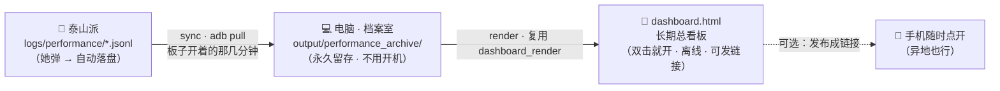

# 43 · 长期归档 —— 不开机也能看

> **一句话定位**：把「看板」从板子上解放出来。板子负责**现场采集**，电脑负责**长期留存**——之后随时看，与开不开机无关。

| 元信息 | 值 |
|---|---|
| 路径 | `E:\obsidian\项目笔记\无障碍吉他改造\43_长期归档_不开机也能看.md` |
| 日期 | 2026-10-09 |
| 状态 | ✅ 工具已落地（`tools/archive_performance.py`，demo 数据验证通过） |
| 关联 | [[39_她的演奏档案_记录层]] · [[41_理解与呈现层_教练引擎与看板]] · [[42_动态看板_并入管理页]] · [[35_网页远程访问_USB转发]] |

---

## ❓ 问题从哪来

Z 的疑问：**「动态看板要开机才能看——那我平时想看里面的东西，不开机怎么办？」**

这个疑问的前提是对的（动态版确实跑在板子上、要开机），但结论可以改：
**「长期查看」根本不需要板子，因为要看的东西是「数据」，不是「板子」。**

---

## 🧠 本质判断

把两件事拆开：

| | 数据在哪产生 | 什么时候需要板子 |
|---|---|---|
| **她的演奏**（现场） | 板子（触摸条 + 舵机 + 麦） | ✅ 必须开机 |
| **演奏之后的数据** | 已经是**普通文件**（`logs/performance/*.jsonl`） | ❌ **不用** |

**档案就是纸。** 板子只是「写字的那支笔」。笔收起来了，写好的纸照样能读——前提是**纸得从板子那本本子上撕下来**。

所以问题不是「怎么让板子一直开着」，而是 **「什么时候、怎么把纸搬到你会长期保留的地方」**。

---

## ✅ 方案：板子=现场采集器，电脑=长期档案室



要点：

1. **采集**：板子照旧跑，档案自动落盘（`her_recorder` 逐行 flush，一行不改）。
2. **搬运**：一条命令把档案从板子拉到电脑固定归档目录。
3. **成表**：电脑上把整个归档渲染成**一份**总看板 HTML（复用 [[41_理解与呈现层_教练引擎与看板]] 的同一份渲染，不会漂移）。
4. **查看**：那份 HTML 就是「长期档案」，放哪都行——**板子关机、断网、没带在身边，都不影响**。

---

## 🛠 工具：`tools/archive_performance.py`

```bash
# 一步到位：从板子拉取 + 刷新长期总看板（推荐）
python tools/archive_performance.py sync \
    --song "歌曲列表/晴天/图片源2/输出结果（deepseek纠正版本）.csv"

# 分步
python tools/archive_performance.py pull      # 只从板子拉档案
python tools/archive_performance.py render    # 只渲染总看板
python tools/archive_performance.py stats     # 归档概览（多少场/多少天/累计时长）

# 手动模式：不从板子拉，直接对某个目录渲染
python tools/archive_performance.py render --archive "D:/某个目录"
```

**默认位置**

| 项 | 默认值 | 说明 |
|---|---|---|
| 归档目录 | `<仓库>/output/performance_archive/` | 可用 `--archive` 或环境变量 `ARCHIVE_DIR` 改 |
| 板子目录 | `/root/guitarist_app/logs/performance` | 可用 `--board-dir` 改 |
| adb | 自动探测（`ADB` 环境变量 > 已知路径 > PATH） | 可用 `--adb` 指定 |
| 输出 HTML | `<归档目录>/dashboard.html` | 可用 `--out` 改 |

**实测输出（demo 数据）**

```
归档目录：E:/音乐/output/demo_performance
  档案总数：4（已收场 4 / 未收场 0）
  练习天数：4 天   累计时长：12.6 分钟
  时间跨度：2026-09-14 ~ 2026-10-08

✅ 长期总看板已生成：E:/音乐/output/archive_dashboard_demo.html（4 场，2026-09-14 ~ 2026-10-08）
   → 双击打开即可，不需要板子、不需要联网。
```

看板文件 76K、6 张内联 SVG、**0 个外部引用** → 真正的离线自包含。

---

## 🔄 两个版本，各管一段

| | **动态版**（[[42_动态看板_并入管理页]]） | **长期版**（本篇） |
|---|---|---|
| 本质 | 跑在板子上的 Flask 服务 | 一份静态 HTML 文件 |
| 要开机 | ✅ 要（它服务「现场实时」） | ❌ 不要（它服务「长期回看」） |
| 什么时候用 | 她现在就在弹 / 答辩现场演示 | 平时翻记录 / 回顾进步 / 给别人看 |
| 数据 | 实时读板子档案 | 读电脑归档目录 |

**两者不冲突，是同一份数据的两个窗口**：
- 板子开着 → 管理页 `/dashboard` 看实时
- 板子关了 → 双击 `dashboard.html` 看长期

---

## 📱 可选延伸：发布成链接（异地/手机随时看）

归档目录里那份 `dashboard.html` 可以**一键发布成在线链接**：

- 之后**任何设备、任何地点**点链接就能看，**与板子、与电脑开不开机都无关**（数据托管在云上）。
- 更新方式：板子开着时 `sync` 一次 → 重新发布 → 同一个链接显示最新。
- ⚠️ 注意：这条路径会把**你的练习数据放到公网**。若只是自己看、不外发，本地归档就够；要发链接时跟我说一声，我确认一下你愿不愿意公开这份数据。

---

## ⚠️ 已知边界（诚实说明）

1. **搬运那一步仍然需要板子开着**——这是物理必然（数据长在板子上）。但它是「几秒钟的一次操作」，不是「为了看一眼而让板子一直开着」。
2. **未收场的档案**（弹到一半断电/服务被杀）也能归档和渲染：`dashboard_render` 有 `derive_partial_summary()`，从现场 events 推一份汇总，不会丢。
3. **教练指标需要曲谱**：不传 `--song` 时看板自动降级为「仅档案指标」（换和弦数/保持时长/超时），传了才有命中率/准时率/偏差。
4. **arduino/adb 环境**：Windows 上 adb 需在 PATH 或用已知路径；Git Bash 下脚本内部已设 `MSYS_NO_PATHCONV=1`，避免 `/root/...` 被改写。
5. **归档是幂等覆盖**，可反复跑，不会重复堆文件（同名覆盖）。

---

## ▶️ 建议节奏

1. **现在**：什么都不用做，工具已就绪。
2. **第一次上板弹完**：跑一句 `sync`（或 `pull`），电脑上就有了第一批真实档案。
3. **想要「全自动」**：把 `sync` 挂成 Windows 计划任务（板子在同一 WiFi 时自动收 + 刷新看板）——说一声我帮你配。
4. **想发链接**：先说一声，确认数据公开范围后再发。

---

[[00_目录]] · [[41_理解与呈现层_教练引擎与看板]] · [[42_动态看板_并入管理页]]
