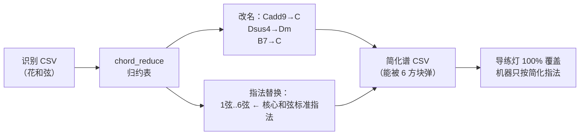

# 44 · 和弦归约层（无障碍简化谱）

> 一句话定位：**把识别出来的"花和弦"归约成"能按的核心和弦"——识别不追"准"，追"能用"。**
> 元信息：代码 `src/guitarist/chord_reduce.py` + 归约表 `data/chord_reduce_map.csv` + 测试 `_test_chord_reduce.py`（27 断言）；日期 2026-10-09；状态 已落地（PC 版）。

## 🔗 相关笔记
[[40_导练层_跟练模式]] · [[41_理解与呈现层_教练引擎与看板]] · [[25_技术方案报告]]

---

## 一、为什么要做它（反直觉的真问题）

演奏盘只有 **6 个触摸方块**（C / G / Am / F / Dm / Em）。而《拨云》的识别器追求"识别得**准**"，认出来的多是：

```
Cadd9  Cmaj7  Em7  Dsus4  Gsus4  A7sus4  D/F  D/A  D9 ...
```

**识别越"精准"，和弦越"花"，落不进 6 方块的就越多。** 结果荒谬但真实：

- 《晴天》611 拍里，**175 拍**用了集外和弦 → 跟练时**和弦灯一大片不亮**
- 机器还得为这些花和弦按复杂指法（对她、对舵机都是负担）

> 这是**无障碍项目该做的事**：原项目追"识别得准"，我们追"识别得**能用**"。

## 二、做了什么



| 件 | 说明 |
|---|---|
| `src/guitarist/chord_reduce.py` | **纯逻辑**（零硬件 / 零外网 / 零 ML）：归约表加载 + 和弦名归约 + CSV 归约 + CLI + 覆盖率报告 |
| `data/chord_reduce_map.csv` | **归约表**（可手改）：`源和弦,归约和弦,说明`，覆盖全部 50 个已知和弦 |
| `src/guitarist/_test_chord_reduce.py` | 27 项断言（归约/兜底/指法替换/非破坏/--no-reshape/--stats），并入 `run_tests.sh`（13 → **14 套**） |

## 三、归约规则（默认表）

| 原和弦族 | 归约到 | 依据 |
|---|---|---|
| C, C7, C9, Cadd9, Cmaj7, Csus4, C6, **Cm**, Cm7 | **C** | 本位 / 加音降级（小调→大调近似） |
| G, G7, G9, Gadd9, Gsus4, G6, **Gm**, Gm7 | **G** | 同上 |
| Am, A7, A6, Amaj7, Asus2/4, A7sus4, Am7, Am7b5, **A** | **Am** | A 家族统一到 Am |
| F, Fmaj7, **Fm**, Fm11, **F#m** | **F** | F 家族（F#m 近位） |
| D, D7, D9, Dsus2/4, Dmaj7, **D/F**, **D/A**, Dm, Dm7 | **Dm** | D 家族 + 转位统一到 Dm |
| E, E7, Esus4, Em, Em6, Em7, Emadd9 | **Em** | E 家族统一到 Em |
| **B, B7, Bm, Bm7** | **C** | 近位根音（B 距 C 仅半音） |

**兜底链**：归约表精确命中 → 根音近位兜底（表外和弦，如 C#m） → 原样返回并标"未识别"。

## 四、实测（拿真曲谱说话）

对《晴天》识别结果的 `输出结果（deepseek纠正版本）.csv`：

```
和弦归约 · 覆盖率报告
  拍数: 611   改名: 422   指法替换: 422
  和弦种类: 13 → 5
  跟练可覆盖(落进 6 方块): 436 → 611 拍   (71% → 100%)
  归约后和弦集: Am C Dm Em G
  归约说明分布: 本位×189, 近位根音(B→C)×35, 转位×23, 大调→小调近似×4
```

**导练引擎权威复核**（shape-first 口径）：

| | 原谱 | 简化谱 |
|---|---|---|
| 灯可提示（已映射方块） | 436 / 611 = **71%** | 611 / 611 = **100%** |
| 未映射（灯不亮） | **175 拍** | **0 拍** |

→ 直接兑现：**跟练从"大片灯不亮"变成全曲可跟练**。

## 五、用法

```bash
# 生成简化谱（默认另存『输出结果（简化和弦版本）.csv』，不覆盖原文件）
python src/guitarist/chord_reduce.py \
  --in  歌曲列表/晴天/图片源2/输出结果（deepseek纠正版本）.csv \
  --out 歌曲列表/晴天/图片源2/输出结果（简化和弦版本）.csv

# 只看覆盖率提升，不写文件
python src/guitarist/chord_reduce.py --in X.csv --stats

# 只改名、不替换指法（保守模式）
python src/guitarist/chord_reduce.py --in X.csv --out Y.csv --no-reshape

# 换归约表（Z 可自定：把 B7 改判给别的方块等）
python src/guitarist/chord_reduce.py --in X.csv --out Y.csv --map data/chord_reduce_map.csv
```

生成后，板子直接读简化谱即可（`歌曲列表/<歌>/图片源N/` 下多一份 CSV，演奏时选它）。

## 六、与识别链（pipeline）的关系

- 《拨云》PC 端识别链 `src/score_recognition/` 是**可插拔 stage** 设计（`pipeline.py` 的 `PipelineStage`）。
- 本层当前是**独立工具**（非侵入、可立即验证），**未改那 1.3 万行主链**。
- 若要"识别完自动出简化谱"，只需在 `data_merger` 之后加一个薄 stage 调 `reduce_csv()`——结构上已支持，留待需要时接。

## 七、⚠️ 已知边界（诚实说明）

1. **音乐近似是主动选择**：`Cm→C`、`B7→C`、`D/F→Dm` 等会**改变原曲和声色彩**（大/小调互换、转位丢失）。这是"能弹"换"原味"的取舍，**归约表可手改**（Z 若在意某个和弦，改一行即可）。
2. **指法也一起简化**：默认会替换 `1弦..6弦`，使**机器也按简化和弦**（不只是一张简化谱面）。要保留原指法用 `--no-reshape`。
3. **只对"6 方块"负责**：归约目标恒为 C/G/Am/F/Dm/Em；若二期扩方块，改 `ROOT_FALLBACK` 与归约表即可。
4. **不解决"识别错"**：归约只做"和弦名→核心和弦"的映射，识别本身的错字仍靠上游（DeepSeek 纠错等）。

## 八、下一步

- （可选）接进 `score_recognition` pipeline 末端，做到"识别完顺带出简化谱"。
- 与 **导练/教练** 联动：板子直接吃简化谱 → 灯 100% 覆盖、教练基准也统一到简化谱。
- 二期若扩触摸方块，回调归约表。
