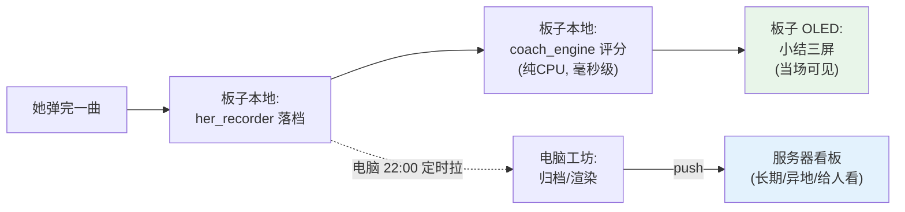

# 46 · 屏幕分层：实时 / 小结 / 服务器

> 一句话定位：她**眼前的屏幕**（板子 OLED）和**远端的屏幕**（服务器看板）分工不同 ——
> 现场看"我这遍打得怎么样"，远端看"练了这么久成了什么样"。**数据在板子上当场算，
> 绝不为了一块屏去等服务器。**

**元信息**
- 所属：[[00_目录]] · 无障碍吉他改造
- 相关：[[45_薄服务器_本地工坊与常驻档案室]] · [[41_理解与呈现层_教练引擎与看板]] · [[39_她的演奏档案_记录层]] · [[40_导练层_跟练模式]]
- 代码：`src/guitarist/session_summary.py` · `oled_renderer.show_session_summary()` · `screen_functions.session_summary_ui()` · `her_recorder.summarize()` · `tools/session_summary_preview.py`
- 日期：2026-10-09 ｜ 状态：✅ 逻辑层 + 渲染方法 + 测试(50 断言) + 电脑预览 + **菜单接线**已完成；⏳ 未上真机

---

## 1. 起因

Z 提出：*"屏幕上也可以显示实时，也可以显示练习数据，还有弹奏有问题的东西；弹完之后电脑定时上传到服务器。"*

这个想法对，但里面藏着一个**必须先说清的判断**。先把三类"屏幕"摆开：

| 层 | 屏幕 | 什么时候看 | 谁算 | 现状 |
|---|---|---|---|---|
| **① 实时** | 板子 OLED 主界面 | 演奏**中** | 板子本地，逐帧 | ✅ 已有（`her_chord`/`her_hint`） |
| **② 小结** | 板子 OLED 小结页 | 刚弹完抬头那一眼 | 板子本地，当场算 | ✅ 本次新建 |
| **③ 回看** | 服务器 `/dashboard` | 事后、异地、给别人看 | 电脑算完推上去 | ✅ 已有（45 号） |

## 2. ⚠️ 关键判断：屏幕上的数据必须**本地算**

Z 的表述里隐含一个陷阱 —— *"弹完了电脑定时上传，上传到服务器"*。如果**屏幕显示也走这条路**，
她弹完要等到晚上 22:00 计划任务跑完才看到反馈，**当场什么都看不到，等于没有**。

所以分工必须是：

- **屏幕要显示的东西 → 板子当场算**。教练评分是纯 CPU、几百拍毫秒级、零硬件，板子完全扛得住。
- **电脑定时上传 → 只管"长期归档 + 异地回看"**，跟当场显示无关。

一句话：**实时与小结靠本地，服务器只管"存档与远看"，不是"数据先去服务器再回来显示"。**

## 3. 三屏版式（适配 128×64 单色）

她的眼睛在琴上，弹完抬头 **≤3 秒**要看完。所以**不再塞数字，只留结论**：

| 屏 | 标题 | 内容 | 数据来源 |
|---|---|---|---|
| 1 | 演奏小结 \[歌名] | `得分 89` / `命中 96% 准时 80%` / `准56 早3 晚8 漏3 误1` | summary.score / hit_rate / on_rate / 计数 |
| 2 | 哪里要练 | `Dm 命中 50% (6拍)` / `F 命中 67% (9拍)` | by_chord，命中率<90% 且样本≥2 拍者，升序取前 3 |
| 3 | 建议 | 人话一句（自动折行为 ≤3 行） | coach_engine.build_advice() 第 1 条 |

电脑预览（`tools/session_summary_preview.py` 生成，模拟板子版式）：

> 预览图路径：`E:\音乐\拨云_开源参考\liguanxi_Automatic_guitar\output\session_summary_preview.png`（**演示数据，非真实演奏**）

**排版细节**（都测过）：
- 中英混排按"显示宽度"折行：中文 2 单位、ASCII 1 单位，一行 20 单位（≈128px）
- **中文标点避头**：折到逗号/句号时把上一行末字一起带下来，避免"…很稳 / ，保持"这种难看断行
- 标题放得下才带歌名（≤13 单位），放不下就让位——屏幕是稀缺资源
- 薄弱和弦过滤"只碰过一次"的偶然失误（样本 <2 拍不列），不误导她去练

### 3.1 两套小结：教练版 / 无曲谱版

| 版本 | 数据来源 | 页 1 | 页 2 | 何时用 |
|---|---|---|---|---|
| **教练版** `build_summary_pages` | coach_engine 评分 | 得分/命中/准时 | 薄弱和弦（命中率） | 有曲谱基准（跟练模式） |
| **无曲谱版** `build_practice_pages` | `her_recorder.summarize()` | 弹了多久/换和弦次数/几个和弦 | **保持超时**的和弦 | 她自由弹（**当前实际接的就是这版**） |

无曲谱版的"问题"来自**舵机保持超时** —— 她按久了没松手（舵机发热），这是自由弹时唯一能客观抓到的"卡壳点"。有曲谱时才谈得上"漏/误按/早晚"。

## 4. 本次新建的件

| 文件 | 跑在哪 | 作用 |
|---|---|---|
| `src/guitarist/session_summary.py` | 板子/电脑 | **纯逻辑**：coach summary → 分屏文本。零硬件、零第三方依赖（连 PIL 都不 import），可单测 |
| `oled_renderer.show_session_summary()` | 板子 | 把一页文本画上 OLED：标题 + ≤3 行 + 右上角页码 |
| `src/guitarist/_test_session_summary.py` | 电脑 | 50 断言，已接入 `run_tests.sh`（第 15 套） |
| `tools/session_summary_preview.py` | 电脑 | 按**真实版式**渲染 128×64 三屏并放大拼图，输出 PNG，无硬件即可看效果 |

`session_summary.py` 的关键设计：**只吃 `dict`（summary）+ `list`（advice）**，不 import `coach_engine`。
好处：① PC 上无字体也能测 ② 不与教练引擎耦合 ③ 兜底建议自备一份，屏幕永远有话说。

## 5. ✅ 已接上（10-09）

落地方式做了调整 —— **没有动 `main.py`，也没新增界面态**。核过代码后发现：
主程序里"菜单功能"（`power_monitor_ui` / `her_performance_ui` / `performance_mode_ui`）
全是**自渲染阻塞循环**：函数自己 `while` 渲染、自己读按键、退出后回菜单。
照这个模子写，**零侵入、零回归风险**（不用碰主循环的 elif 链，也不用碰按键逻辑）。

| 文件 | 改了什么 |
|---|---|
| `her_recorder.py` | 新增公开方法 `summarize()` —— 演奏**进行中**也能取本场即时汇总（原先只有 `end_session` 才吐 summary） |
| `session_summary.py` | 新增 `build_practice_pages()` / `weak_by_timeout()` / `pages_from_recorder()`（无曲谱版） |
| `screen_functions.py` | 新增 `session_summary_ui()` —— 自渲染循环：UP/DOWN 翻页、ESC 返回菜单 |
| `menu_system.py` | 根菜单新增入口「演奏小结」（排在「演奏模式」之后） |
| `oled_renderer.py` | `show_session_summary` 加"有提示就保留底行"规则，防空提示压字 |

⚠️ 一个必须知道的前提：**her 模式没有"一曲弹完"这个事件** —— 它是一开一关的
长会话（`start()` 开一场、`stop()` 收一场）。所以小结不是"自动弹出来"的，
而是**她从菜单点「演奏小结」主动看**。将来接上跟练模式（有 `GuidePlan`）后，
可以在曲终自动弹。

**验收**：`_test_menu_entry.py` 里用假按键 + 假渲染器**实跑了这个界面** ——
三屏渲染、DOWN/UP 翻页、ESC 退出回菜单、无档案时降级提示，全通过。

## 6. 诚实说明边界

- **接线已完成，但仍是"主动看"**：不会自动弹小结（her 模式无曲终事件）；要从菜单进。
- **未上真机**：板子 OLED 上尚未实跑；字号/行高按现有 `font_small=12` 版式推的，实测若过挤再微调。
- **当前接的是"无曲谱版"**：因为跟练模式（`GuidePlan`）尚未接进主程序。教练版（判漏/误按/早晚）代码已备好，等跟练上板即可切换。
- **预览图为演示数据**，不代表任何真实成绩。
- 小结只反映"碰方块"的时机（现有传感器边界），**无拨弦传感** → 不评价右手。
