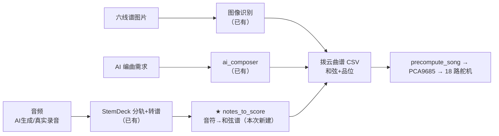

# 47 · 分轨接入：从音频到吉他动作

> **一句话**：把「AI 生成 / 真实录音的音乐」经**分轨 → 转谱 → 和弦识别**，变成《拨云》能直接弹的曲谱 CSV —— 补上了这条链路里唯一缺的那一跳。

| 项 | 值 |
|---|---|
| 日期 | 2026-10-09 |
| 状态 | ✅ 转换器建成并实测 · ✅ 已合并进服务器 `/music` · ⏳ 未上真机 |
| 代码 | `tools/notes_to_score.py`（转换器）· `src/guitarist/_test_notes_to_score.py`（35 断言，第 16 套） |
| 上游项目 | `E:\MusicStripper_desktop\stemdeck_new`（**StemDeck**：GPU 分轨 + 转谱） |
| 关联 | [[45_薄服务器_本地工坊与常驻档案室]] · [[44_和弦归约层_无障碍简化谱]] · [[46_屏幕分层_实时小结与服务器]] |

## 1. 这一层解决什么

Z 的原话：*"让 AI 生成的一个音乐，那个音乐是没有谱子的，就要去分谱，分到吉他谱，然后吉他谱直接转换成舵机的动作。"*

这正好补上一个**《拨云》原本覆盖不到的场景**：



**关键洞察**：三条来路最后都收口到**同一个 CSV 格式**（`横线数量/区域1-6/类型/1-6弦/拍号/BPM`）。所以只需补中间那一跳，所有来源就都能驱动同一套动作。

## 2. 缺口的位置与两侧格式

| 侧 | 产物 | 内容 |
|---|---|---|
| **上游**（StemDeck 转谱） | `jobs/<id>/sheets/<轨>.jianpu.json` | `notes[{start, length, pitch, intensity}]` + tempo/拍号/调 |
| | 同目录 `<轨>.mid` / `.musicxml` / `.svg` | 标准 MIDI / 乐谱 / 谱面图 |
| **下游**（《拨云》舵机） | 曲谱 CSV | 每行一个和弦（`类型`）+ 六弦品位（`1弦..6弦`）+ 拨弦位（`区域1..6`） |

中间缺的是：**音符流 → 和弦序列**。这是 MIR 领域的"和弦识别"，但本项目的约束把它简化了 —— 舵机**只按 0~4 品**，且《拨云》已有 **50 个和弦的固定指法表**（`data/chord_definitions.csv`），所以不需要通用识别，只需**在已有的 50 个手型里找最匹配的那个**。

## 3. 转换器怎么做的

`tools/notes_to_score.py`，零第三方依赖：

1. **读音符流**：内置最小 SMF 解析器（不依赖 mido/music21），或直接吃 StemDeck 的 `jianpu.json`
2. **扫时间网格**（默认半拍）分两路取样：
   - `onset` —— 本格**新起音**（最准，代表"这一拍弹了什么"）
   - `ctx` —— 本格附近的**发声上下文**（琶音一格只有一个音时补足）
   - 本格有 ≥2 个新起音就只信 onset，否则两者合并
3. **匹配和弦**：把音高集合（pitch class）与 50 个手型逐一比，算 **F1**（召回=和弦音被覆盖、精确=观测音落在和弦内），再给"低音=根音"加成
4. **可选归约**：按 `data/chord_reduce_map.csv` 归到 **6 大方块**（C/G/Am/F/Dm/Em）
5. **合并连续同和弦** → 输出 CSV；反复行时品位继承

**`--max-fret 4` 是硬约束**：超出 4 品会被 `servo_controller` 的 `min(4, fret)` 夹掉 → 弹错音。所以定位音高时**优先用手型内的弦**，否则做**八度折叠**折回 0~4 品，实在放不下就留空。

```bash
# 单首
python tools/notes_to_score.py jobs/xxx/sheets/guitar.jianpu.json -o 吉他谱.csv --reduce --report
# 批量（扫分轨项目，每首取 guitar 轨）
python tools/notes_to_score.py --batch E:/MusicStripper_desktop/stemdeck_new/jobs --track guitar --reduce
```

## 4. 实测数据（真实分轨产物）

输入：StemDeck 分出的 **guitar 轨**（`test_music`，1513 音符，BPM 96，4/4，原曲调性 F# min）

| 指标 | 结果 |
|---|---|
| 音符 → 和弦段 | 1513 → **339 段** → 629 行 CSV |
| 平均匹配分 | **0.858** |
| 低置信段（<0.5） | **3 / 339**（0.9%） |
| 识别出的和弦族 | A / D / E / F#m / Bm —— **与原曲 `keyName=F#` 自洽** |
| 归约后分布 | Am 109 · F 83 · Em 72 · C 45 · Dm 29 · G 1（**全覆盖 6 块**） |

**下游验收**（最关键的一步）：把生成的 CSV 喂给 `ServoController.precompute_song()` ——

```
precompute_song → 638 音符 | 拍号 4/4 | BPM 96
区域列最大品位: 4（无越界）
含压弦动作的音符: 638 / 638
首音符 23 字节长度: 23 → ✅ 合法
```

也就是说，**音频分轨出来的谱，真的变成了舵机能执行的二进制时间线**。

## 5. 合并进服务器（复用吉他那套）

Z 定的"合并"= **两个项目共用同一台阿里云 ECS 的那套只读档案室**，不新建服务、不加端口、不改口令。

| 改动 | 文件 | 说明 |
|---|---|---|
| 加数据源 | `deploy/server_sync.json` + `.example` | 新增 `music` 源，`include: ["*.musicxml","*.mid","*.jianpu.json"]`、`flatten` |
| 歌名目录 | `tools/push_to_server.py` | 新增 `name_from` 字段 —— 从上游 `metadata.json` 读 `title` 当目录名（否则会是 `bf3409ba79ef` 这种哈希） |
| 站点加页 | `deploy/server_site.py` | 新增 `/music`：按目录分组列出各声部乐谱，可点开下载；落地页加第三张卡片 |

推送 + 重启后实测：`/srv/guitar/music/` 下按**歌名**分组（`test_music/`、`鸾音社-一两相思二两愁/`），首页显示"5 个曲谱文件 · **27 个分轨乐谱**"。

> 生产服务器是宝塔 + nginx + MySQL 在跑的机器，全程**只做隔离新增**（已有的 `guitar-site` 服务、`/srv/guitar` 目录），没碰任何现有服务。

## 6. 诚实说明边界

- **和弦识别不保证 100% 准**：0.9% 的低置信段就是明证（编曲复杂、声部分离不干净时会错）。但《拨云》的舵机只需要"像原曲的和弦走向"，**不追求逐音还原**，这个精度对"她跟着弹"够用。
- **只判"碰方块"所属的和弦**：转换器取的是**音高集合**，不还原原始节奏细节（琶音的每个音被归并成一个和弦段）。要更细的节奏，得改 `--grid`（默认半拍）。
- **未上真机**：CSV 只做了 `precompute_song` 的软件验收，**没有真的发到 ESP32 / 舵机上跑过**。
- **StemDeck 侧没动**：没有把这一步接进分轨项目的 pipeline，是**外部调用**（`--batch` 指向它的 jobs 目录）。分轨项目保持独立。
- **版权提醒**：AI 生成音乐的版权归属另说；用真实歌曲分轨出谱自用可以，**公开分发有风险**。

## 7. 下一步

1. **上真机**：把 `output/stem_scores/test_music_简化和弦.csv` 放进板子 `歌曲列表/`，跑一次整曲播放，看舵机是否按和弦变化动作
2. 想更贴原曲：调 `--grid`（半拍→四分之一拍）保留更多节奏细节
3. 可选：把这一步挂进 `push_daily.py`，或做成"放首歌到某个目录就自动出谱"的监听
