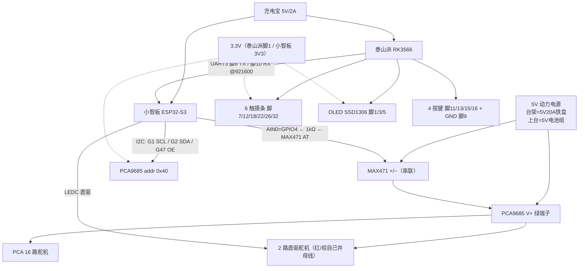

# 48 · 接线总表（重接专用 · 一张纸版）

> 一句话：**把线弄乱之后，照这一张从头接回去**——脚号全部来自已实机验证的 [[29_触摸条硬件验收]]、[[32_PCA9685与小智板接线]]、[[34_上台前接插清单]]、[[38_MAX471电流采样接线与验收]]，未验证的一律标注。
>
> 路径：`E:\obsidian\项目笔记\无障碍吉他改造\48_接线总表_重接用.md` ｜ 2026-10-09 ｜ 状态：**照抄可接**  
> 用途：清线重接 / 换线材 / 上台前复核

---

## 〇、接线前先背这三句

| # | 纪律                                      | 为什么                                         |
| - | --------------------------------------- | ------------------------------------------- |
| 1 | **先接信号地，最后上动力 5V**                      | 带电插拔 = 打火、烧芯片                               |
| 2 | **全系统必须共地**（泰山派 = 小智板 = PCA = 电源− = 舵机） | 不共地 → 扫不到 0x40 / 串口乱码 / 舵机乱抽                |
| 3 | **脚号只认表，不靠外推**                          | 本项目在这上面翻过两次车（树莓派排布外推全错、引脚卡把 GPIO3 印成 GPIO0） |

---

## 一、全景拓扑（先认全局，再动手）



> 记忆点：**5V 管"转得动"，3.3V 管"听得懂"**。PCA9685 是全系统唯一跨两域的芯片（V+ 走 5V、VCC 走 3.3V）。

---

## 二、泰山派 40PIN（★ 照这张插）

### 2.1 信号类

| 去向           | 物理脚    | GPIO     | 备注                         |
| ------------ | ------ | -------- | -------------------------- |
| 触摸 C1（C 和弦）  | **7**  | GPIO1_A4 | ✅ 实测通                      |
| 触摸 C2（G）     | **12** | GPIO3_C4 | ✅                          |
| 触摸 C3（Am）    | **18** | GPIO3_A5 | ✅                          |
| 触摸 C4（F）     | **22** | GPIO3_A6 | ✅                          |
| 触摸 C5（Dm）    | **26** | GPIO3_A7 | ✅                          |
| 触摸 C6（Em）    | **32** | GPIO3_C5 | ✅                          |
| OLED **SDA** | **3**  | I2C2_SDA | ✅ 实测通，0x3C                 |
| OLED **SCL** | **5**  | I2C2_SCL | ✅                          |
| →小智板 **TX**  | **8**  | UART3_TX | ✅ 实测通                      |
| ←小智板 **RX**  | **10** | UART3_RX | ✅                          |
| 按键 UP        | **11** | GPIO3_A1 | 一端脚11、一端 GND               |
| 按键 DN        | **13** | GPIO3_A3 | ⚠️ 注意 A3/A2 与脚号**不单调**，照表接 |
| 按键 SET       | **15** | GPIO3_A2 |                            |
| 按键 ESC       | **16** | GPIO3_A4 |                            |

### 2.2 电源类

| 脚              | 电压       | 接什么                                      |
| -------------- | -------- | ---------------------------------------- |
| **1**          | **3.3V** | **VCC 束**（6 触摸 + OLED，共 7 根，10-07 已焊成一束） |
| 17             | 3.3V     | 留空备用                                     |
| **2 / 4**      | **5V**   | ☠️ 禁用（插上就烧模块）                            |
| **6**          | GND      | **GND 束**（OLED + 6 触摸，共 7 根）             |
| **9**          | GND      | **按键 GND 束**（4 根拧一束）                     |
| 14             | GND      | 备用（推荐留空，别乱插）                             |
| 20/25/30/34/39 | GND      | 备用（全相通）                                  |

> ☠️ **插脚 1 是全场最危险一步**：脚 1=3.3V、脚 2=5V **紧邻**。插前必量：黑笔任一 GND、红笔点脚 1 → **读出 3.3V 才插**；读 5V = 数错格重数。  
> ☠️ **插脚 6 也要数清**：两边是脚 5(SCL)、脚 7(触摸C1)。插偏 → 屏不亮 / C1 没反应。验证：屏亮 + 按 C1 出和弦 = 对。  
> ⚠️ **脚 39 在这块板是 GND**，但小智板上 **G39 是舵机直驱信号脚** —— 两块板别混。

### 2.3 禁插清单（OUT 绝不能进）

```
1/17(3.3V) · 2/4(5V) · 6/9/14/20/25/30/34/39(GND) · 3/5(I2C) · 8/10(UART) · 11/13/15/16(按键)
```

### 2.4 OLED 专段（SSD1306 128×64）

代码依据：`hardware.py:109-110` → `busio.I2C(board.I2C2_SCL, board.I2C2_SDA, frequency=400000)` + `SSD1306_I2C(128, 64, i2c)`。

| OLED 引脚 | 落点 | 说明 |
|---|---|---|
| **VCC** | **脚 1（3.3V）** | ★ **与 6 个触摸条 VCC 共用同一束**（焊接版共 7 根） |
| **GND** | **脚 6（GND）** | ★ **与 6 个触摸条 GND 共用同一束** |
| **SCL** | **脚 5** | GPIO0_B5 · I2C2_SCL · 单独一根 |
| **SDA** | **脚 3** | GPIO0_B6 · I2C2_SDA · 单独一根 |

**参数**：I2C2 总线 @ **400kHz** · 地址 **0x3C** · 分辨率 **128×64 单色** · 中文字体 NotoSansCJK 在位。

**两个坑**：
1. ☠️ **VCC 只能接脚 1**：接成脚 2/4 的 5V → 屏当场烧。插前量：黑笔任一 GND、红笔点脚 1 → 必须 3.3V。
2. ⚠️ **模块丝印顺序不统一**：有的印 `GND VCC SCL SDA`、有的印 `VCC GND SCK SDA`。**按名字接，不按位置**；标 `SCK` 的就是 SCL。

**验收**：`i2cdetect -y 2` 应看到 **0x3C**；屏亮、文字正常 = 通。

### 2.5 彩屏专段（微雪 1.83″ ST7789 240×284 · SPI）— 37 号课题

> 换屏 = 一期硬件升级。接口从 I2C 变 SPI，旧 OLED 的脚 3/5 **摘掉**；屏功率大（背光 ~120mA），**不再挂那束 3.3V/GND，改独立取电**。

| 屏脚 | 物理脚 | GPIO | 说明 |
|---|---|---|---|
| **VCC** | **17** | 3.3V | 独立取电（脚 1 已被 VCC 束占） |
| **GND** | **14** | GND | 独立接地，与全系统共地 |
| **DIN**(MOSI) | **19** | GPIO4_C3 | SPI3_MOSI |
| **CLK**(SCLK) | **23** | GPIO4_C2 | SPI3_CLK |
| **CS** | **24** | GPIO4_C6 | SPI3_CS0（硬件片选） |
| **DC** | **29** | GPIO3_B0 | 任意空闲脚 |
| **RES**(=RST) | **31** | GPIO3_C2 | 屏丝印常印 **RES** 不是 RST；接上最稳（不接靠软复位） |
| **BL**(背光) | **17** | 3.3V | 与 VCC 同路（偏暗再挪 5V 脚 2/4） |

> 🔴 **37 号笔记原写的 `CS=23 / SCK=21 / DC=24` 是错的**（当时靠猜，GPIO 名也全错）。正确 = **MOSI 19 · CLK 23 · CS 24**，21 是 MISO（屏不用）。以本表为准。
> ★ **10-10 用立创官方 40PIN 表逐项复核（Z 提供）**：脚19=GPIO4_C3=SPI3_MOSI、脚23=GPIO4_C2=SPI3_CLK、脚24=GPIO4_C6=SPI3_CS0、脚29=GPIO3_B0、脚31=GPIO3_C2 —— **与反推表完全一致**。GPIO 全局号：**DC(脚29)=104**、**RES(脚31)=114**（换算式 `bank*32 + 组*8 + 序`，A/B/C/D=0/1/2/3）。⚠️ 此前脚本误用 115(GPIO3_C3，此板 40PIN 上没有该脚)，已修。
> ⚠️ **1.54″ 240×240 版**（Z 手上这块）：8 针 = `BLK CS DC RES SDA SCL VCC GND`，**有独立 RES**。BLK→脚1或17(3.3V)、VCC→脚17、GND→脚14。分辨率 240×240（脚本 `--w 240 --h 240`）。**屏背面先看丝印**：`DRIVER IC: ST7789` 才是 ST7789 序列。
> ⚠️ **SPI 只有这一路**（板定义仅一组 MOSI/MISO/SCLK/CS0）。一期计划的 WS2812 灯带也走 MOSI(19)+CLK(23) —— 两者**共用总线、错开时序**即可（灯带不吃 CS，屏用 CS0 片选）。
> ⚠️ **装驱动前先看屏背面丝印**：Rev1 = NV3030B、Rev2 = ST7789P，**两种驱动不通用**，装错 = 白屏。
> 反推依据：板定义 28 个 GPIO 按序对应 40PIN 的 28 个信号脚（跳 1/2/4/6/9/14/17/20/25/30/34/39），已用实测脚 3/5/7/8/10/11/12/16/18/22/26/32 **全部命中**。


---

## 三、小智板 ESP32-S3 ↔ PCA9685（控制侧）

| PCA9685 针   | 接小智板    | 说明                 |
| ----------- | ------- | ------------------ |
| **SCL**     | **G1**  | 固件 `PIN_I2C_SCL=1` |
| **SDA**     | **G2**  | 固件 `PIN_I2C_SDA=2` |
| **OE**      | **G47** | 低有效；不接 → 舵机全不动     |
| **VCC**（逻辑） | **3V3** | ☠️ **不是 5V**       |
| **GND**     | GND     | 共地                 |

小智板侧其余已定：**G41/G42 = UART ↔ 泰山派脚 8/10**（保持不动）；**G40 / G39 = 2 路舵机直驱**。

| PCA9685       | 版本事实（10-06 实测）                                                    |
| ------------- | ----------------------------------------------------------------- |
| V+ 与 VCC 是否连通 | ✅ **天生分离**（蜂鸣档 OL 不响）→ 致命点① 豁免，但仍须保证 VCC 只接 3.3V                  |
| OE 是否引出       | ✅ 已引出（6 针排针第 5 针）                                                 |
| 通道怎么认         | ⚠️ **本板不印数字** → **离 V+ 绿端子第 N 格 = 固件 chN**（最近格=ch1，最远格=ch16，直线编号） |
| 绿色端子极性        | **左 = GND、右 = V+**（四点交叉验证定死）                                      |

---

## 四、18 路舵机通道表（★ 照这张插）

### 压弦 12 个（每弦 2 路：ch0 品12组 / ch1 品34组）

| 弦     | ch0                   | ch1    |
| ----- | --------------------- | ------ |
| 第 1 弦 | **GPIO40 直驱**（不插 PCA） | PCA 15 |
| 第 2 弦 | PCA 13                | PCA 11 |
| 第 3 弦 | PCA 9                 | PCA 7  |
| 第 4 弦 | **GPIO39 直驱**（不插 PCA） | PCA 16 |
| 第 5 弦 | PCA 14                | PCA 12 |
| 第 6 弦 | PCA 10                | PCA 8  |

### 拨弦 6 个

| 拨弦 index | 0 | 1 | 2 | 3 | 4 | 5 |
| -------- | - | - | - | - | - | - |
| PCA 通道   | 2 | 4 | 6 | 1 | 3 | 5 |

> 规律：**PCA 1~~6 = 拨弦，PCA 7~~16 = 压弦**。

### 那 2 路直驱怎么接（★ 一个针都不插 PCA）

| 舵机线        | 接到                     | 做法                      |
| ---------- | ---------------------- | ----------------------- |
| **橙（信号）**  | 小智板 **G40 / G39**      | 直接插                     |
| **红（+5V）** | 5V 母线（PCA V+ 端子 / 汇流排） | 与其余 16 个同一根 5V          |
| **棕（GND）** | GND 母线                 | ★★ **漏这根 = 舵机绝对不动**，先查它 |

**绿色端子孔小塞不进 3 根 → 引线分流**：一根杜邦两端剥皮，一端单根进端子孔，另一端与 2 根舵机红线（+电源红线）孔外**绞 6~8 圈并上锡**，热缩管包死。

> ⚠️ 杜邦线 26AWG 只扛 ~~1A：**台架空跑够用，上琴带力矩前必须换粗线**（16~~18AWG）。

---

## 五、MAX471 电流采样（一期升级地基件）

| 通道          | MAX471 接法                                                                   |
| ----------- | --------------------------------------------------------------------------- |
| **压弦组（必接）** | **+/− 串联**在电源 → PCA V+ 的动力主路上；**AT → 1kΩ → 小智 GPIO4（AIN0）**；VCC→3.3V；GND→共地 |
| 拨弦组（可后补）    | 另串一路；AT → 1kΩ → **GPIO5（AIN1）**                                             |

**手头只有一块**：先接压弦组，**AIN1(GPIO5) 用杜邦线接地**（悬空读数会漂）。

三个坑：① ±3A 量程会削顶（实测峰值 3.12A），过流保护本阶段不可信 ② AT 悬空 = 读数满偏 ③ 模块有方向性（+进−出），接反读负。

---

## 六、电源分配（台架 / 上台 两套）

| 场景         | 动力（舵机 + PCA V+）                       | 逻辑（两块板）       |
| ---------- | ------------------------------------- | ------------- |
| **台架（现在）** | **5V20A 铁盒**（MWISH S-100-5，插 220V 市电） | 电脑 2 根 USB    |
| **上台**     | **5V/5A 电池组**（typec 公母顶替 5V20A）       | **充电宝 5V/2A** |

> ⚠️ "5V20A"是 **AC-DC 开关电源输出 5V 直流**，不是让你把市电接舵机上。  
> ⚠️ 上台**动力与逻辑必须分开**：舵机浪涌会把共用的 5V 拉垮 → 泰山派重启 = 最坏事故。  
> ⚠️ 逻辑侧**禁用 Type-C PD 口**（会协商 9V/12V 烧板），只认 USB-A 恒 5V。

**上电顺序**：① 先逻辑（充电宝/电脑）→ 等屏幕亮 → ② 再动力（电池/铁盒）。**收工反向：先断动力，再断逻辑。**

---

## 七、五个致命点（接线时逐条打勾）

| # | 风险                  | 后果                           | 做法                           |
| - | ------------------- | ---------------------------- | ---------------------------- |
| ① | PCA V+ 与 VCC 连通跳线未断 | 5V 灌进 I2C 上拉 → **烧 GPIO1/2** | 本板天生分离（已验），但 **VCC 只接 3.3V** |
| ② | 没共地                 | I2C 失败、舵机抽搐                  | 四者物理连通                       |
| ③ | OE 没接 G47           | 舵机全不动                        | 接上（固件驱动它）                    |
| ④ | 舵机动力走面包板            | 面包板 1A 熔板                    | 16~18AWG 直连、端子拧紧             |
| ⑤ | 先上电后接线 / 带电插拔       | 打火烧芯片                        | 先信号+地，最后上 5V                 |

---

## 八、接完怎么验（从小到大，别跳步）

**Step 1 · 只接控制线，不插舵机** → 打开串口（115200）应出现：

```
[I2C] bus ready: SDA=2 SCL=1 @400kHz
[HW] profile=XIAOZHI ... pca_oe=47
[PCA9685] OK addr=0x40 16ch        ← ★ 关键行，扫到就算通
```

**Step 2 · 接 1 个舵机 + 5V 动力**（先量电源 5.0~5.2V）→ 点动：

```
PCA 1 0      →  PCA 1 180        # ch1 = 离 V+ 最近那一格
```

**Step 3 · 插满 16 路 PCA → 逐路点名**（走马灯，看是否"从 V+ 那端依次亮过去"）→ **再单独接 2 路直驱**：

```
PWM 0 30 → PWM 0 150 → PWM 0 90   # GPIO40 = 第 1 弦 ch0
PWM 1 30 → PWM 1 150 → PWM 1 90   # GPIO39 = 第 4 弦 ch0
```

**Step 4 · 全 18 路回中位**（也是装机械件前的标准动作）：

```
ALL 90        # 压弦行程归零，齿条全部缩回 → 才能装到琴颈上
```

USB 调试台命令表（小智板 CH340 口 **115200**，业务帧 UART 是 921600，**别混**）：

| 命令                 | 说明                  |
| ------------------ | ------------------- |
| `PCA <ch> <ang>`   | ch = 1~16           |
| `PWM <id> <ang>`   | id = 0/1（GPIO40/39） |
| `ALL <ang>`        | 18 路统一角度            |
| `AIN [ch]`         | 读 ADC 0~4           |
| `STATUS`           | 电流/温度 + 使能/演奏状态     |
| `RESET_PROTECTION` | 清过流锁存               |

脚本（在 `E:\音乐\档3实现\`）：`read_esp32_log.py COM5 115200 10`、`send_esp32_cmd.py "PCA 1 0" "PCA 1 180"`。跑前 `unset PYTHONPATH`。

---

## 九、原始笔记索引（要细节翻这些）

| 笔记                               | 内容                                      |
| -------------------------------- | --------------------------------------- |
| [[29_触摸条硬件验收]]                   | 6 触摸脚号实证 + 去抖修正 + 三坑                    |
| [[32_PCA9685与小智板接线]]             | 接线定稿（25KB，最全）+ 通道表 + 上电三步 + 三级供电体系      |
| [[34_上台前接插清单]]                   | 40PIN 落点终版（脚1/6/9）+ 4 按键 + 双电源 + her 模式 |
| [[38_MAX471电流采样接线与验收]]           | MAX471 接线 + 四步验收 SOP                    |
| [[17_小智板接线与烧录SOP]]               | 小智板侧接线 + 固件烧录                           |
| [[19_GOOUUU_ESP32-S3-CAM_引脚与资料]] | 小智板引脚实照定位                               |

---

## 十、待收尾（10-09 状态）

- ⏳ **PCA ch13~16 走马灯复点**（10-06 遗留"到 13 就没了"，判为供电/接触面）
- ⏳ V+ 端子杜邦引线 → 上琴带载前换粗线
- ⏳ MAX471 到货接线 + 四步验收
- ⏳ **舵机装琴颈前必须先 `ALL 90`**（齿条不缩回会顶住安装面）

---

## 十一、2026-10-11 变更：四按键 → TTP223 触摸（硬件换代）

**起因**：四键从上线起全部无反应。排查定案——**本板内核不支持运行时上下拉**
（`gpioget --bias=pull-up` 被拒；Blinka 的 `Pull.UP` 是静默假动作），按键另一端接 GND
的接法在无上拉的板上**恒读 0，按下也不变**。四条线焊接、公共地、按键本体均无问题。
全芯片扫描：40PIN 上"天生带默认上拉的空闲脚"只剩脚 37（不够四个）。
→ 决定用 **TTP223 触摸模块替换**（推挽输出，主动驱动电平，天然不需要上拉）。

**新接线（2026-10-11 定稿）**：

| 模块 | SIG（信号） | VCC | GND |
| --- | --- | --- | --- |
| TTP223 ①（UP） | **脚 11**（GPIO3_A1） | **并进脚 1 的 3.3V 公共束** | 脚 9 / 6 / 14 |
| TTP223 ②（DOWN） | **脚 13**（GPIO3_A3） | 同上 | 同上 |
| TTP223 ③（SET） | **脚 15**（GPIO3_A2） | 同上 | 同上 |
| TTP223 ④（ESC） | **脚 16**（GPIO3_A4） | 同上（并进脚 1 的 3.3V 公共束） | 脚 9 / 6 / 14 |

> ⚠️ **TTP223 模块丝印不统一（信号脚三种印法）**：表里写的 `SIG` 在实物上可能印成 **`SIG` / `OUT` / `I/O`** —— **三者同义**，都接上表 SIG 列。
> **按名字接，不按位置**：排针顺序 `VCC-GND-OUT` 或 `GND-VCC-OUT` 都可能，位置靠不住。
> 模块背面若有 **`A/B` 焊盘** = 输出模式选择，**保持出厂 A 模式**（点动、触摸=高电平），代码按高有效处理。**别动它**。

- 脚 1、脚 17 两个 3.3V 都已被占（脚1=VCC 公共束，脚17=彩屏），**VCC 一律并进脚 1 那束**
  （原 7 根 → 10 根；TTP223 电流 <5mA/个，无压力）
- **原机械按键信号线必须从脚 11/13/15/16 拔掉**（TTP223 推挽输出，机械键再接地 = 短路输出）
- 模块背面 A/B 焊盘**保持出厂 A 模式**（触摸 = 高电平）；代码侧按**高有效**处理
- ☠️ 红线不变：**脚 2/4 = 5V 禁用**；焊完上电前必量脚 1 = 3.3V（紧邻脚 2，数错格就烧）
- **ESC 缺件期软件兜底**：选歌屏 20s 无输入自动退回主界面（`button_handler._song_idle_start`）——第 4 个 TTP223 装好后此路径基本不走
- 代码侧：`hardware.BTN_ACTIVE_HIGH`（**全项目唯一真相源**）= `{up:高, down:高, set:高, esc:高}`（换硬件只改这张表）；`button_handler._pressed()` / 各屏 `is_pressed()` 全部折算到它；`hardware.py` 已撤掉无效 Pull.UP
- ✅ **2026-10-11 下午：第 4 个 TTP223（ESC）到货并安装** → 设置界面入口（主界面**长按 ESC 2s** → `cs=1`）恢复可用；**软件零改动**（`BTN_ACTIVE_HIGH["esc"]` 早就是高有效）
  - 接线：SIG→**脚 16** · VCC→并进**脚 1** 3.3V 束 · GND→**脚 9**（或 6/14）
  - 接线前先拔掉原机械键在脚 16 的信号线（TTP223 推挽输出再接地 = 短路）；上电前量脚 1 = 3.3V

> ⚠️ **同期硬件事故**：反复欠压（舵机堵转）导致泰山派 **eMMC 文件系统损坏**
> （ext4 errors_count 3.3 万条且持续增长，根分区切只读、系统二进制读不出）→ 需 Maskrom 线刷。
> 舵机供电问题解决前，板子不得带舵机长时间上电；「演奏空闲 N 秒自动 `disable_all`」列为刷机后第一批。
