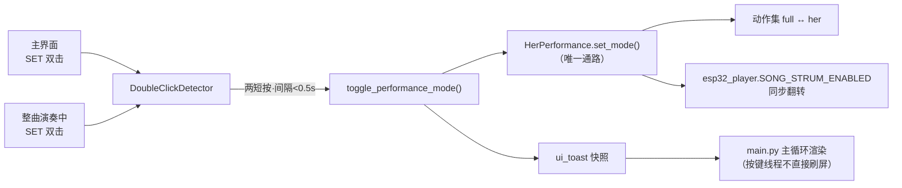

# 54_一键切换模式_双击SET

> **一句话**：把「全自动弹唱 / 人机配合」的切换，从"长按 ESC 进菜单 → 演奏模式 → SET"压缩成 **主界面双击 SET** 一步到位；演奏中也能切（但整曲对当前这首不生效，见第七节）。
> 元信息：`E:\obsidian\项目笔记\无障碍吉他改造\54_一键切换模式_双击SET.md` · 2026-10-10 · 状态 **已实现 + 单测全绿（PC 侧），待上板实测**
> 关联：[[23_最终形态与两种模式]] · [[24_her模式守护层_就位提示与超时保护]] · [[37_放大屏一期_1.83寸彩屏替换]] · [[48_接线总表_重接用]] · [[52_彩屏演奏主界面]]

---

## 一、需求（Z 2026-10-10 口述）

> "全自动和半自动……它可以自动弹唱，也可以切换成人机配合模式……我们当时有四个按钮，但实际上按钮好像也没有太大作用，所以想把这个按钮中选一个，作为切换人机和自动弹唱的方式……右手可以选择卸掉压/拨弦的，用手来弹；全自动就是两个都装上，它自动弹。"

拆成两条：

1. **两种模式 = 机器做多少**（不是"谁来触发"）：
   - **全自动弹唱** = 压弦 12 + 拨弦 6 + 换把，**机器全包**；
   - **人机配合（半自动）** = 机器**只压弦**；拨弦·节奏·力度全归她的手 → 物理上 = **卸掉右手拨弦机构**。
2. **四个按键里选一个**，做模式切换的快捷键（现在按钮"没太大作用"）。

---

## 二、先核对：这件事**已经存在一大半了**

| 你的想法 | 现状（本轮之前） | 结论 |
|---|---|---|
| 两种模式并存 | `trigger_source.MODE_FULL / MODE_HER`、`MODE_ACTIONS` 两张动作集（23 号笔记已落地） | ✅ 已有 |
| 运行时可切、不重启、不松弦 | `HerPerformance.set_mode()` → 只改内存里的动作集 | ✅ 已有 |
| 全自动 = 机器也拨弦 | `esp32_player.SONG_STRUM_ENABLED = True`（整曲播放） | ✅ 已有 |
| 半自动 = 机器只压弦 | `SONG_STRUM_ENABLED = False` → 拨弦角度全部静音到 `point_a` 静止位（`mute_strum_in_notes`） | ✅ 已有 |
| 触发权在人（触摸条带动舵机） | `TTP223×6` 触摸条 = `PerformanceController` 的触发源；菜单「她的演奏」为兜底入口 | ✅ 已有 |
| **按键一键切模式** | 只能长按 ESC 进菜单 →「演奏模式」 | ❌ **缺这个** ← 本轮补 |

> 所以本轮**没有**新增"模式"概念，只是给已有模式加了一个**物理快捷入口**——不新开第二条切换通路（纪律见下）。

---

## 三、两个必须先说清的硬件事实

### ① 那块 1.83 寸彩屏**不能触控**
37 号笔记明确写死：**"不做触屏——你买的是带 0.5mm 圆角的扩展板，没有电容触控"**。
→ "用触摸屏切模式"物理上不存在。能用的只有 **触摸条** 或 **四个按键**。
→ 你说的"用触摸屏带动舵机"= **触摸条**触发压弦，那条路已经通了，本轮没动它。

### ② 四个按键在主界面的真实占用

| 按键 | GPIO | 主界面下的作用 | 是否空闲 |
|---|---|---|---|
| 上 UP | `GPIO3_A1` | 无（只在菜单里当导航） | ✅ 空闲 |
| 下 DOWN | `GPIO3_A3` | 无（只在菜单里当导航） | ✅ 空闲 |
| **SET** | `GPIO3_A2` | push-to-talk（**仅唤醒方式=按键 时才真在用**） | ✅ 基本空闲 |
| ESC | `GPIO3_A4` | 长按 2s 进 / 出菜单 | ❌ 已占用 |

Z 选定 **SET 双击**（而不是上/下长按）。现场口径：本机无麦、AI 整体关闭（37 号笔记），SET 实际上没有占用。

---

## 四、设计



四条设计纪律：

| # | 纪律 | 为什么 |
|---|---|---|
| 1 | **单一通路**：只调 `HerPerformance.set_mode()` | 动作集与 `SONG_STRUM_ENABLED` 天然同步（`trigger_integration.py:258`），不新开第二条切换路 |
| 2 | **按键线程不刷屏**：只写 `ui_toast` 状态快照，由 `main.py` 主循环渲染 | 按键线程与主循环同时写同一块屏 = 必花 |
| 3 | **PTT 自动让位**：唤醒方式=按键 时双击识别整个关闭 | "按住说话"的行为**一个字节都不变** |
| 4 | **如实回报**：门面"保持不变"时不谎报目标值 | 沿用 23 号笔记"未知模式保持不变"的纪律 |

**双击判定口径**（`DEFAULT_MAX_GAP=0.5s` / `DEFAULT_MAX_PRESS=0.4s`）：
两次**短按**（每次 <0.4s），且两次**按下**间隔 <0.5s → 在**第二次释放沿**判定成功。
长按（≥0.4s）不参与双击 → 与任何"长按语义"天然不冲突。

---

## 五、改动清单

| 文件 | 改动 |
|---|---|
| **`src/guitarist/mode_toggle.py`** 🆕 | 核心：`DoubleClickDetector`（纯逻辑）· `toggle_performance_mode(hp=...)`（唯一切换入口，可注入桩）· `next_mode / label_for / toast_lines / stamp_toast` |
| `button_handler.py` | 主界面新增 SET 双击分支；`_is_ptt_mode()` 让位判断；`_do_mode_toggle()` 写 `ui_toast` |
| `screen_functions.py` | `play_song` **播放循环**加 SET 双击；采样周期 200ms → **50ms**（否则 ~100ms 短按会被整个漏掉） |
| `main.py` | 主界面渲染分支：优先渲染 `ui_toast`，过期即清 |
| `state.py` | 新增 `ui_toast` 状态键（含 `reset_state_for_boot` 复位） |
| **`src/guitarist/_test_mode_toggle.py`** 🆕 | 11 段单测（A~K） |

---

## 六、验证证据（全部实跑）

```
$ python _test_mode_toggle.py
A. 单击不算双击                                  ✅
B. 两短按 + 间隔 0.2s < 0.5s → 恰第二次释放沿报 True  ✅
C. 长按（0.9s）不参与双击                          ✅
D. 两次点击间隔 0.8s > 0.5s → 不算双击               ✅
E. 三连击 → False/True/False（只报一次）            ✅
F. next_mode / label_for / toast_lines（≤10字/行）  ✅
G. full→her→full 双向可逆                         ✅
H. 未装配（hp=None）→ ok=False / no_instance，不抛异常 ✅
I. set_mode 抛异常 → ok=False / set_failed 降级不崩  ✅
J. 门面"保持不变" → 按实际结果回报，不谎报 her          ✅
K. stamp_toast → {lines, until} 结构               ✅
```

回归（项目 venv 实跑，**全过**）：

| 测试 | 结果 |
|---|---|
| `_test_modeswitch.py` | ✅ full/her 运行时可切、双向可逆、未知输入保持不变、门面与控制器同步 |
| `_test_actionset.py` | ✅ 全动作 = 压弦+拨弦；减法 = `[chord]` 只压弦 |
| `_test_menu_entry.py` | ✅ 菜单「演奏模式」调用链 `[('set_mode','her')]`、**切模式不松弦** |
| `_test_song_her.py` | ✅ 门面切换 → `SONG_STRUM_ENABLED` 即时同步；拨弦静音只留压弦时间线 |
| `_test_her_guard.py` | ✅ 守护层全链路（就位提示 / 超时自动松弦 / 换和弦隔离） |
| `py_compile`（6 文件） | ✅ 通过 |

---

## 七、诚实边界（已知未闭合，**别当成已经做到**）

### ① 整曲自动播放：**演奏中途切，对当前这首不生效** 🔴

整曲是**一次性预计算下发**的（`esp32_player._send_binary_fast`：把 632 音符角度一次性算完、打包灌给 ESP32，之后由板子**自主播放**，与上位机动作集解耦）。

- 所以演奏中双击 SET：**模式确实切了**，`SONG_STRUM_ENABLED` 也翻了，但**已下发的拨弦帧改不了** → **下一首才生效**。
- 屏幕提示里**如实标注**"本曲不生效·下一首"，不让操作者误以为当场变了。
- **对照**：触摸触发 / 单音触发是**逐次读动作集**（`PerformanceController._has()`），**立即生效**。

> 若要"中途切立刻生效"，唯一办法是**停曲 → 按新模式重新下发 → 重新开演**（会有几秒空档 + 舵机复位动作）。**本轮没做**，需要的话单独提。

### ② `her_performance_ui` 界面内不识别双击
那个界面里 **SET 已经是"压住/松开和弦"键**（23 号笔记的兜底压弦入口），再叠双击会互相打架 → 本轮**故意不接**。要切模式请回主界面，或在进入该界面前切好。

### ③ 独立脚本 `auto_play_show.py` 不覆盖
`E:\音乐\档3实现\auto_play_show.py` 是**独立进程**（跑之前要先 `stop guitar 服务`），它**根本不跑按键线程** → 双击 SET 在那个脚本里无效。要覆盖需在该脚本里自己拉一条按键轮询（**待办**）。

### ④ 20ms 采样 vs 双击手感
主界面由按键线程 20ms 轮询，判定很稳；演奏循环是 50ms 轮询，两次点击间隔上限 0.5s 足够宽松。**但真实手感需上板实测**（尤其机械按键的抖动与回弹），手感不对就调 `DEFAULT_MAX_GAP / DEFAULT_MAX_PRESS`。

### ⑤ 切到 `full` 前的物理前提
`full` 会去驱动**拨弦 6 路**。若当时右手机械**已卸掉**（半自动形态），固件仍会按 `point_a/point_b` 输出 → 空转/噪声。所以切 `full` 的提示文案特意写成 **「已切 全自动 / 请确认拨弦已装」**，把这条前提摆在操作者眼前。

---

## 八、待办

- [ ] **上板实测**：主界面双击 SET → 屏幕弹出「已切 人机配合 / 机器只压弦」；再双击 → 「已切 全自动 / 请确认拨弦已装」
- [ ] 实测双击手感（若太灵敏/太迟钝 → 调 `max_gap` / `max_press`）
- [ ] 决定是否要"演奏中途切立刻生效"（= 停曲重下发的方案），要则单开
- [ ] 决定是否给独立脚本 `auto_play_show.py` 也加拉一条按键轮询
- [ ] 若将来打开"唤醒方式=按键"的语音 PTT，复测双击是否按预期让位
